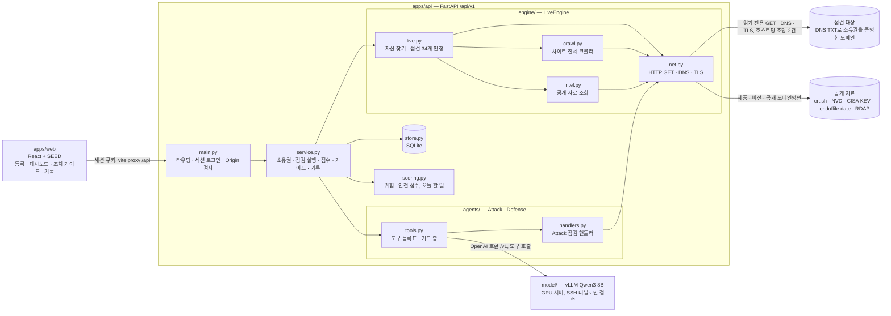

<p align="center"></p>

# A2D (Attack to Defense)

> **AI가 공격을 누구나 할 수 있게 만들었다면, A2D는 방어를 누구나 할 수 있게 만든다.**

보안팀 없이 서비스를 만드는 팀을 위한 외부 노출 점검 서비스. 도메인을 등록하면 공격자가 약한 고리를 찾는 순서 그대로, 침입 없이 읽기 요청만으로 점검하고, 점수 하나와 "오늘 할 일 3가지"를 알려 준다. 이름은 읽으면 aid(도움)다. 코디세이 AI 해커톤 2026 출품작.

## 기획 의도

A2D는 세 막짜리 이야기에서 출발했다. 근거는 [문제 정의 근거 사례](docs/research/A2D_문제정의_근거사례.md)에 모았다.

| 막 | 이야기 | 근거 |
| --- | --- | --- |
| **1막. 공격은 누구나** | AI 덕분에 누구나 서비스를 만들고, 누구나 공격한다 | AI 앱 빌더로 만든 170개 프로젝트에서 공개 키만으로 개인정보가 열렸다(CVE-2025-48757). IT 비전공자가 AI 침투 도구로 병원·학원·상조회사에서 개인정보 820만 건을 빼냈다(2026.10 송치) |
| **2막. 방어는 전문가만** | 그런데 지키는 사람은 예전 그대로다 | 종사자 10~249명 기업의 평균 정보보호 담당 인력은 1.3명, 침해를 알아차리기까지 평균 106.1일. 관리자 화면에 IP 제한 하나 없어 과징금 1억 6,800만 원을 받은 회사도 있다 |
| **3막. A2D** | 보안 지식이 없어도 찾고, 순서를 정하고, 고친 것을 확인할 수 있게 한다 | 아래 "A2D가 하는 일" |

**누구를 위한 서비스인가.** AI 코딩 도구와 Supabase 같은 BaaS로 개인정보를 다루는 서비스를 만들어 직접 운영하는 1~3명 팀이다. 코드와 도메인은 직접 쥐고 있지만 보안 교육은 받은 적 없고, 대표가 "우리 괜찮아?"라고 물으면 답하기 어려운 개발자다. 시연은 이런 팀이 만든 가상 채용 플랫폼 JobNest로 한다.

**A2D가 하는 일.** 모두 지금 저장소에서 동작한다.

| 하는 일 | 내용 |
| --- | --- |
| 찾는다 | 하위 도메인, 크롤러로 찾은 숨은 경로, 공개 파일, 화면 코드 속 비밀키, Supabase·Firebase 공개 접근, 열린 관리자 화면 |
| 순서를 정한다 | 공개된 계산식으로 위험 점수를 매기고, 고쳤을 때 안전 점수가 가장 많이 오르는 세 가지를 고른다. 순위에 LLM은 관여하지 않는다 |
| 쉬운 말로 설명한다 | AI가 이유와 예상 피해를 쓰고, 코드가 그 문장이 실제 발견과 맞는지 확인한 뒤에만 보여 준다. 맞지 않거나 LLM이 없으면 팀이 쓴 기본 가이드로 대신한다 |
| 고친 것을 확인한다 | 재점검을 직전 점검과 비교해 해결됨·새 자산·새 노출을 보여 준다 |
| 건드리지 않는다 | 소유를 증명한 도메인에만, 읽기 요청(GET·DNS·TLS)만, 호스트당 초당 2건 이하로 보낸다 |

시연에서는 첫 점검 20점 F가 오늘 할 일 세 가지(로그인 없이 지원자 연락처가 보이는 API, 웹에 남은 백업 파일, 외부에 열린 관리자 화면)를 차례로 고치자 30점, 49점, 100점 A가 된다.

**아직 계획인 것.** 정해진 시간에 자동으로 도는 매일 점검과 메일·메신저 알림, 배포 전 점검, Supabase 테이블별 접근 규칙 심층 점검, 로그인 뒤 권한 점검. 근거와 순서는 [기획서](docs/A2D_기획서.md)의 확장 로드맵에 있다.

## 저장소 구조

서비스, 모델 배포, 시연용 타깃 서버를 한 저장소에 둔다(모노레포).

| 경로 | 내용 | 담당 |
| --- | --- | --- |
| [apps/web/](apps/web/README.md) | A2D 프론트엔드: 등록·대시보드·조치 가이드·기록 4개 화면 | 정인호 |
| [apps/api/](apps/api/README.md) | A2D 백엔드: 소유권 확인, 자산 발견·점검 엔진, 위험 점수, Attack·Defense 에이전트 | 김성원, 김강현(에이전트) |
| [model/](model/README.md) | AI 모델 배포 스크립트: GPU 서버에서 Qwen3-8B를 vLLM으로 서빙, GPU 서버 설정 순서 | 김강현 |
| [target/](target/README.md) | 타깃 서버: 결함을 일부러 심은 가상 채용·인재 매칭 플랫폼(시연 대상) | 김성원 |
| [docs/](docs/) | 기획서, 상세 설계, 점검·점수 설계, PRD, API 명세, 정보 구조도 | 김강현 |
| [brand/](brand/logo/README.md) | 로고와 색 | 김강현 |

작업 방식(GitHub flow, 브랜치·커밋·PR 규칙)은 [CONTRIBUTING.md](CONTRIBUTING.md)를 따른다.

## 아키텍처

화면(`apps/web`)은 백엔드(`apps/api`)의 HTTP API만 부른다. 백엔드 안에서 점검 엔진(`engine/`)이 소유권을 증명한 대상에 **읽기 전용** 요청을 보내 자산과 발견을 만들고, 점수와 오늘 할 일은 코드(`scoring.py`)가 계산하며, LLM(`agents/`)은 추가 점검 계획과 조치 설명만 맡는다. LLM이 없어도 점검·점수·기본 가이드는 동작한다.



### 점검 1회의 흐름

1. **등록·소유권** — 화면에서 도메인을 등록하면 `service.py`가 TXT 값을 만들고, `dnspython`으로 `_a2d-verify.<도메인>` 레코드를 확인한 도메인만 점검 대상이 된다.
2. **자산 찾기** — `live.py`가 하위 도메인 단어 목록(#1)과 crt.sh 인증서 발급 기록(#5)으로 호스트를 모으고, `crawl.py`가 첫 화면·robots·사이트맵·JS 번들을 따라 같은 도메인 안의 경로를 찾는다.
3. **기본 점검** — `live.py`가 모은 페이지·JS·헤더·인증서로 34개 항목을 판정하고, `intel.py`가 제품·버전으로 알려진 취약점(#23)·지원 종료(#25), 도메인명으로 등록 정보(#33)를 공개 자료에 묻는다. 발견은 `EngineContext`를 통해 자산 ID·가린 증거(200자 이내)로만 넘어간다.
4. **추가 점검 (Attack 에이전트)** — LLM이 기본 결과를 보고 도구 이름과 자산 ID만 제안하면 `tools.py`의 가드 층이 허용 목록·범위·인자·예산(도구 호출 20회, 30분)을 검사한 뒤 `handlers.py`의 읽기 전용 핸들러를 실행한다. LLM에는 URL을 받는 도구가 없다.
5. **점수·오늘 할 일** — `scoring.py`가 발견마다 4요소(노출도·악용 용이성·데이터 민감도·자산 중요도)와 신뢰도로 위험 점수를, 조직 전체의 0~100 안전 점수와 A~F 등급을, "고치면 점수가 얼마나 오르나"로 오늘 할 일 3가지를 계산한다. LLM은 관여하지 않는다.
6. **조치 가이드 (Defense 에이전트)** — LLM이 조회 도구로 근거를 읽고 항목마다 발견 ID를 붙여 제출하면, 실제 발견과 연결되지 않은 문장은 버린다. LLM이 없으면 항목별 기본 가이드를 쓴다.
7. **기록·재점검** — 결과는 `store.py`(SQLite)에 남고, 재점검하면 이전 점검과의 변화(새 자산·새 노출·점수)를 비교한다.

| 모듈 | 하는 일 | 설계 문서 |
| --- | --- | --- |
| `main.py` · `auth.py` · `errors.py` | 엔드포인트 22개, 세션 로그인, Origin 검사, 오류 형식 | [API 명세](docs/A2D_API명세.md) |
| `service.py` · `store.py` | 도메인·점검·발견·가이드·기록의 상태 관리와 저장 | [상세설계](docs/A2D_상세설계.md) |
| `catalog.py` · `scoring.py` | 점검 항목 34개, 항목별 기본값, 점수 계산식 | [점검·점수 설계](docs/A2D_점검점수설계.md) |
| `engine/base.py` | API와 엔진 사이의 약속: `Engine`·`EngineContext`·`Budget`·`RawAsset`·`RawFinding` | 상세설계 4절 |
| `engine/net.py` · `crawl.py` · `intel.py` · `live.py` | 대상에 닿는 통로, 크롤러, 공개 자료 조회, 점검 판정 | 상세설계 1·4절 |
| `agents/tools.py` · `handlers.py` | 에이전트별 도구 허용 목록, 가드 층, Attack 점검 핸들러 | 상세설계 4절 |
| `target/` | 결함을 심은 가상 채용 플랫폼(app) + TLS 프록시(nginx) + 시연 DNS(CoreDNS) | [target/README.md](target/README.md) |
| `model/` | GPU 서버에 vLLM으로 Qwen3-8B를 띄우고 SSH 터널로 붙는 스크립트 | [model/README.md](model/README.md) |

## 문서

| 파일 | 내용 |
| --- | --- |
| [docs/A2D_기획서.md](docs/A2D_기획서.md) | 핵심 문장과 3막 이야기, 핵심 타깃, 서비스, AI 활용, 차별점, 안전, MVP, 효과와 확장 로드맵, 팀, 위험 |
| [docs/A2D_상세설계.md](docs/A2D_상세설계.md) | 점검 구현 범위·안전 제한 요약, LLM 선택, Python 함수 도구 호출 설계 |
| [docs/A2D_점검점수설계.md](docs/A2D_점검점수설계.md) | 비파괴 점검 항목 34개(1차 29개), 위험·안전 점수 계산식, 항목별 기본값, 시나리오 검증 |
| [docs/A2D_PRD.md](docs/A2D_PRD.md) | 기능 FR-01~16, 화면, AI, 비기능, 범위 밖, 마일스톤 |
| [docs/A2D_API명세.md](docs/A2D_API명세.md) | 프런트엔드가 쓰는 백엔드 HTTP API: 엔드포인트 22개(세션 로그인 포함), 요청·응답 예시, 화면별 호출 순서 |
| [docs/A2D_정보구조도.md](docs/A2D_정보구조도.md) | 로그인과 화면 4개의 구역·이동 경로·구역별 API, 사용자 흐름, 화면 상태와 용어 |
| [docs/A2D_시연진행.md](docs/A2D_시연진행.md) | 시연을 반복해서 찍는 순서: 처음 한 번 준비, 테이크마다 할 일과 화면, 결과가 같게 나오는 조건, 실수했을 때 |
| [docs/research/A2D_문제정의_근거사례.md](docs/research/A2D_문제정의_근거사례.md) | 핵심 문장과 3막 이야기(공격은 누구나, 방어는 전문가만, A2D)를 받치는 실제 사례·수치와 출처, 쓰면 안 되는 표현 |
| [docs/research/A2D_도메인선정_근거검증_사례28건.md](docs/research/A2D_도메인선정_근거검증_사례28건.md) | 채용·인재 매칭 플랫폼을 대표 사례·시연 도메인으로 고른 근거와 사고 사례 28건 |
| [docs/research/A2D_채용플랫폼_필요점검리스트.md](docs/research/A2D_채용플랫폼_필요점검리스트.md) | 채용 플랫폼 우선 점검 항목, 안전 조건, 구현 순서 |

## 브랜드

- [brand/logo/](brand/logo/README.md): 확정 로고(후보 7 "한붓 라인") SVG·PNG와 사용 규칙
- [brand/logo-candidates/](brand/logo-candidates/README.md): 로고 후보 7종 SVG와 콘셉트

## 실행 방법

시연 환경은 한 노트북에서 타깃 서버(`target/`)와 A2D 백엔드(`apps/api/`)를 Docker로, 화면(`apps/web/`)을 Node로 띄운다. Docker와 Docker Compose v2, Node.js가 필요하고, 인터넷은 처음 이미지·패키지를 받을 때만 쓴다. 자세한 설정은 각 디렉터리의 README를 본다.

```bash
cp apps/api/.env.example apps/api/.env   # A2D_ADMIN_EMAIL, A2D_ADMIN_PASSWORD를 채운다
./a2d-demo.sh up        # 타깃 서버(시연 프로필 #16 #8 #18) → 백엔드 → 화면. http://localhost:4173
# 등록 화면에서 도메인 jobnest.test를 넣은 뒤
./a2d-demo.sh verify    # 백엔드에서 TXT 값을 읽어 시연 DNS에 넣는다. 화면에서 "확인"을 누른다
./a2d-demo.sh status    # 세 부분의 상태, LLM 연결(꺼져 있으면 붙이는 방법), 끝난 점검 수
./a2d-demo.sh down
```

| 명령 | 하는 일 |
| --- | --- |
| `up` | `target/demo.sh up`·`preset demo` → `apps/api`에서 `docker compose up -d --build` → `VITE_USE_MOCK=false`로 화면을 빌드해 `vite preview`로 띄운다. 화면 주소가 `A2D_WEB_ORIGIN`에 없으면 띄우기 전에 멈춘다 |
| `reset` | 새 테이크 준비. 결함을 시연 프로필로 되돌리고 백엔드 데이터(점검 기록·등록 도메인)를 지운다. 도메인을 다시 등록하고 `verify`부터 한다 |
| `verify [값]` | 값을 비우면 `apps/api/.env` 계정으로 백엔드에 로그인해 시연 도메인의 TXT 값을 읽어 `target/demo.sh verify`에 넘긴다 |
| `restart-api` | `apps/api/.env`(LLM 주소 등)나 백엔드 코드를 고친 뒤 백엔드만 다시 빌드해 띄운다(`docker compose up -d --build --force-recreate api`). 점검 기록과 결함 상태는 그대로 둔다 |
| `fix`·`break`·`preset`·`test-server`·`check`·`dns-on`·`dns-off` | `target/demo.sh`에 그대로 넘긴다 |
| `logs api\|web\|target` | 로그 보기. 화면 로그와 프로세스 번호는 `.demo/`에 둔다 |

- 화면 포트는 `A2D_WEB_PORT`(기본 4173)로 바꾼다. 바꾼 주소는 `apps/api/.env`의 `A2D_WEB_ORIGIN`에도 넣는다.
- LLM은 GPU 서버에 VPN과 SSH 터널로 붙어야 해서 스크립트가 터널을 열지 않는다. `status`가 OS에 맞는 `A2D_LLM_BASE_URL`과 `model/.env`의 `TUNNEL_BIND`를 알려 준다([model/README.md](model/README.md#백엔드에서-부르기)). LLM이 없으면 조치 가이드는 기본 가이드로 나간다.
- 점검 엔진은 `LiveEngine`이다. 타깃 서버에 읽기 요청만 보내 실제로 점검하고, 결과는 결함 상태대로 나온다. 소유권은 언제나 TXT 레코드로 확인한다(`verify`가 시연 DNS에 넣는다).

테이크를 반복하는 순서와 단계별 화면·명령은 [docs/A2D_시연진행.md](docs/A2D_시연진행.md)에, 타깃 서버의 결함별 세부는 [target/README.md](target/README.md) "시연 순서"에 있다. 그 표의 결함 조작(`preset`·`fix`·`test-server`)은 루트에서 `./a2d-demo.sh`로도 쓸 수 있다.

## 외부 자원

사용한 외부 모델·오픈소스·공개 데이터(API)는 모두 이 표에 적는다. 새 라이브러리·모델·외부 조회를 추가하는 PR은 이 표에도 한 줄을 더한다. 버전은 `apps/web/package-lock.json`, `apps/api/requirements*.txt`, `target/app/requirements.txt`, `target/compose.yml`, `model/.env.example`에 고정한 값이다.

| 자원 | 용도 | 라이선스 |
| --- | --- | --- |
| Qwen3-8B | Attack·Defense 에이전트 LLM | Apache 2.0 |
| vLLM 0.31.0 | 모델 서빙 (OpenAI 호환 엔드포인트) | Apache 2.0 |
| PyTorch (vLLM 0.31.0이 함께 설치하는 버전, 설치 시 2.13.0) | 모델 실행 | BSD-3-Clause |
| Hugging Face Hub CLI (`hf`, vLLM 의존성) | 모델 가중치 내려받기 | Apache 2.0 |
| uv 0.13.6 | GPU 서버 Python 3.12 가상 환경·패키지 설치 | Apache 2.0 · MIT |
| FastAPI 0.115.6 · Uvicorn 0.34.0 | A2D 백엔드 API, 타깃 서버 앱 | MIT · BSD-3-Clause |
| httpx 0.28.1 | A2D 백엔드 HTTP 클라이언트: 읽기 전용 점검·크롤링, 공개 자료 조회, LLM 호출 | BSD-3-Clause |
| dnspython 2.7.0 | A2D 백엔드 DNS: TXT 소유권 확인, 하위 도메인 찾기(#1), 점검 DNS 고정, SPF·DMARC(#32) | ISC |
| cryptography 44.0.0 | A2D 백엔드 TLS 인증서 해석(#28), 타깃 서버 시연 인증서 생성 | Apache 2.0 · BSD |
| certifi 2024.12.14 | A2D 백엔드 HTTPS 검증 CA 묶음(httpx가 사용) | MPL-2.0 |
| bcrypt 4.2.1 | A2D 백엔드 비밀번호 해시 | Apache 2.0 |
| pytest 8.3.4 | A2D 백엔드 테스트(개발용) | MIT |
| Python 3.12.8 slim (Docker 이미지) | A2D 백엔드·타깃 서버 실행 환경 | PSF |
| nginx 1.27.4-alpine (Docker 이미지) | 타깃 서버 TLS 프록시 | BSD-2-Clause |
| CoreDNS 1.11.3 (Docker 이미지) | 타깃 서버 시연 DNS | Apache 2.0 |
| curl 8.11.1 (Docker 이미지) | 타깃 서버 응답 확인(`demo.sh check`) | curl 라이선스(MIT 계열) |
| React 19.3.1 · Vite 8.3.5 · TypeScript 7.0.2 | 프런트엔드 화면과 개발 서버 | MIT · MIT · Apache 2.0 |
| [SEED Design](https://github.com/daangn/seed-design) (@seed-design/react 3.1.0 · css 3.1.0 · vite-plugin 2.1.1) | 프런트엔드 디자인 시스템(주식회사 당근마켓). UI 스니펫을 CLI(`npx @seed-design/cli`, 복사 시점 1.7.3)로 `apps/web/seed-design/`에 복사해 쓰고 LICENSE·NOTICE를 함께 둠. 브랜드 색은 A2D 색으로 덮어쓰고 당근 브랜드 리소스는 쓰지 않음 | Apache 2.0 |
| @karrotmarket/react-monochrome-icon 1.32.0 | 프런트엔드 아이콘(SEED 아이콘 세트) | Apache 2.0 |
| React Router 7.18.5 | 프런트엔드 화면 이동 | MIT |
| Motion 14.9.0 | 프런트엔드 화면 전환·숫자 애니메이션 | MIT |
| clsx 2.1.1 | 프런트엔드 className 결합(SEED 복사 스니펫이 사용) | MIT |
| Pretendard 1.3.9 | 프런트엔드 글꼴(오프라인용으로 패키지에 포함) | OFL-1.1 |
| Vitest 5.0.5 · jsdom 30.1.3 · Testing Library (jest-dom 7.0.1 · react 16.3.3 · user-event 14.6.8) | 프런트엔드 테스트(개발용) | MIT |
| oxlint 1.90.0 · @vitejs/plugin-react 6.1.2 · @types/node·react·react-dom | 프런트엔드 린트·빌드 플러그인·타입 정의(개발용) | MIT |

### 공개 데이터·API

점검 엔진이 점검 중에 묻는 공개 자료다. 대상 서버의 응답이나 개인정보는 보내지 않고, 제품·버전 문자열(#23·#25)과 공개 도메인명(#5·#33)만 묻는다. 모든 요청에 A2D 점검임을 밝히는 User-Agent를 붙이고(`apps/api/a2d/engine/net.py`), 조회에 실패하면 "모름"으로 두고 보고하지 않는다(`apps/api/a2d/engine/intel.py`).

| 자원 | 용도 | 라이선스·조건 |
| --- | --- | --- |
| [crt.sh](https://crt.sh) (Sectigo 공개 인증서 투명성 로그) | #5 인증서 발급 기록으로 단어 목록에 없는 하위 도메인 찾기. 점검당 1회 | 무료 공개 서비스. 별도 라이선스 없음, 이용 제한을 지킨다 |
| [NVD CVE API 2.0](https://nvd.nist.gov/developers/vulnerabilities) (NIST) | #23 알려진 취약점·CVSS. 선택 사항 `A2D_NVD_API_KEY` | 미국 정부 공개 자료. API 이용 조건에 따라 고지한다: "This product uses the NVD API but is not endorsed or certified by the NVD." |
| [CISA KEV](https://www.cisa.gov/known-exploited-vulnerabilities-catalog) 카탈로그 | #23 실제 악용이 확인된 취약점 | 미국 정부 공개 자료 |
| [endoflife.date](https://endoflife.date) API v1 | #25 지원 종료 일정 | MIT |
| [IANA RDAP 부트스트랩](https://data.iana.org/rdap/dns.json) · 각 레지스트리 RDAP 서버 | #33 도메인 만료일·이전 잠금 | 공개 |
