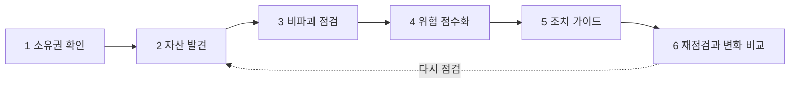

# A2D 기획서

Oct 30, 2026 · 김강현 · 11월 1일 갱신(핵심 문장, 3막 이야기, 핵심 타깃)

**AI가 공격을 누구나 할 수 있게 만들었다면, A2D는 방어를 누구나 할 수 있게 만든다.** A2D(Attack to Defense)는 보안팀 없이 서비스를 만드는 팀을 위한 외부 노출 점검 서비스다. 도메인을 등록하면 공격자가 약한 고리를 찾는 순서 그대로 침입 없이 점검하고, 점수 하나와 "오늘 할 일 3가지"로 무엇부터 막을지 알려 준다. 그 뒤에서 Attack 에이전트가 더 살펴볼 곳을 고르고, Defense 에이전트가 결과를 쉬운 말로 풀어 준다(aid).

| 한눈에 | 내용 |
| --- | --- |
| 해커톤 주제 | 02 AI 기반 정보보호 서비스 |
| 문제 | AI 덕분에 누구나 서비스를 만들고 누구나 공격할 수 있게 됐지만, 지키는 일은 아직 전문가의 몫이다. 소규모 기업의 정보보호 담당 인력은 평균 1.3명이고, 침해를 알아차리기까지 평균 106일이 걸린다 |
| 핵심 타깃 | AI 코딩 도구와 BaaS로 개인정보를 다루는 서비스를 만들어 직접 운영하는 1~3명 팀. 시연은 이런 팀이 만든 가상 채용 플랫폼으로 한다 |
| 서비스 | 도메인 등록 → 대시보드(안전 점수와 A~F 등급, 오늘 할 일 3가지) → 조치 가이드 → 재점검으로 해결됨·새 노출 확인 |
| AI | Attack 에이전트가 추가 점검을 고르고, Defense 에이전트가 발견을 쉬운 말로 푼다. 판단과 검증은 코드가 한다. 모델은 Qwen3-8B(오픈 가중치)를 주최 측 GPU 서버에서 쓴다 |
| 안전 | 소유권을 증명한 도메인만, 읽기 요청만으로 점검. AI 문장은 실제 발견과 맞아야 조치 가이드에 실린다 |
| 시연 | 가상 채용 플랫폼을 점검하고, 오늘 할 일 세 가지(지원자 API, 백업 파일, 관리자 화면)를 차례로 고치면 20점 F가 100점 A가 된다 |
| 팀 | 김강현(AI·발표), 김성원(백엔드·데브옵스), 정인호(프런트엔드) |

## 핵심 문장과 이름

**한 문장으로 말하면 "AI가 공격을 누구나 할 수 있게 만들었다면, A2D는 방어를 누구나 할 수 있게 만든다"이다.** 이름은 이 방향을 담는다. A2D는 "공격에서 방어로(Attack to Defense)"이고, 읽으면 "aid(도움)"가 된다. 보안팀이 없는 팀에 필요한 것은 큰 솔루션이 아니라 지금 당장 할 수 있는 첫 도움(first aid)이고, A2D가 내놓는 "오늘 할 일 3가지"와 조치 가이드가 그 도움이다.

| 글자 | 뜻 | 서비스에서 하는 일 |
| --- | --- | --- |
| A | Attack | 공격자가 외부 접점을 찾는 순서와 방법을 그대로 따른다 |
| 2 | to | 그 방법을 관찰만 하는 비파괴 점검으로 바꾼다 |
| D | Defense | 위험 점수와 조치 우선순위로 방어 행동을 만든다 |
| 읽으면 | aid | 보안팀 없는 조직을 위한 첫 도움 |

### 3막 이야기

발표와 문서는 같은 세 막을 따른다. 근거와 출처는 [문제 정의 근거 사례](research/A2D_문제정의_근거사례.md)에 있다.

1. **1막. 공격은 누구나:** AI 덕분에 누구나 서비스를 만들고, 누구나 공격한다. AI 앱 빌더로 만든 170개 프로젝트에서 공개 키만으로 개인정보가 열렸고, IT 비전공자가 AI 침투 도구로 병원·학원·상조회사에서 개인정보 820만 건을 빼냈다.
2. **2막. 방어는 전문가만:** 그런데 지키는 사람은 예전 그대로다. 담당 인력은 평균 1.3명이고, 뚫려도 106일 동안 모른다. 작은 회사가 처분받는 이유는 관리자 화면에 IP 제한 하나 없는 것 같은 기초적인 빈틈이다.
3. **3막. A2D:** 보안 지식이 없어도 공격자가 보는 곳을 먼저 찾고, 무엇부터 고칠지 정하고, 고친 것을 확인할 수 있게 한다. AI가 쓴 문장은 코드가 사실을 확인한 뒤에만 보여 주고, 점검은 아무것도 건드리지 않는다.

### 해커톤 주제 부합

주제 02 "개인정보와 정보자산을 보호하고 보안 위협을 탐지하고 예방하는 AI 서비스"에 대응한다. 주제 문구처럼 결과물은 에이전트가 아니라 담당자가 쓰는 서비스다. A2D는 외부 노출 자산(정보자산)을 찾고, 노출·설정 오류·알려진 취약 버전(위협)을 탐지하고, 공격자보다 먼저 조치하게 해(예방) 개인정보 유출 경로를 막는다.

## 문제 정의

**AI는 서비스를 만드는 일과 공격하는 일을 동시에 쉽게 만들었지만, 지키는 일은 그대로 두었다.** 1막과 2막을 실제 사례로 정리한다.

### 1막. 누구나 만들고, 누구나 공격한다

| 쪽 | 사례 | 출처 |
| --- | --- | --- |
| 만드는 쪽 | AI 앱 빌더 Lovable로 만든 170개 프로젝트, 303개 엔드포인트에서 Supabase 접근 규칙(RLS)이 빠져, 화면 속 공개 키만으로 이메일·전화번호·결제 정보를 읽을 수 있었다(CVE-2025-48757) | [Superblocks](https://www.superblocks.com/blog/lovable-vulnerabilities) |
| 만드는 쪽 | Tea 앱에서 이미지 약 7만 2천 장이 노출됐고, 그중 약 1만 3천 장이 셀카와 신분증이었다 | [Security Affairs](https://securityaffairs.com/180539/data-breach/hackers-leak-images-and-comments-from-women-dating-safety-app-tea.html) |
| 공격하는 쪽 | 영상과 블로그로 해킹을 배운 IT 비전공자가 AI 침투 도구로 병원·학원·보험판매 업체·상조회사에서 개인정보 820만 건을 탈취했다(2026년 10월 송치) | [비즈워치](https://news.bizwatch.co.kr/article/mobile/2026/10/28/0028) |
| 공격하는 쪽 | 고도의 기술이 없는 해커가 생성형 AI로 55개국 장비 600대 이상을 침해했다. 노린 것은 노출된 관리 포트와 약한 자격증명이었다 | [보안뉴스](http://www.boannews.com/news/articleView.html?idxno=142347) |

공격자는 크기를 보고 고르지 않고, 열려 있는 곳을 찾는다. 2026년 10월 연쇄 침해도 출발점은 핵심 시스템이 아니라 그 옆에 붙은 외부 접점이었다.

#### 10월 연쇄 침해의 출발점

| 피해 조직 | 뚫린 접점 | 규모 | 출처 |
| --- | --- | --- | --- |
| 금융회사 20곳 | 대출모집인 조회 API 인증 우회, 영업지원시스템, 외부 웹페이지 | 개인정보 약 10만 건(10월 14일, 16곳 기준) | [파이낸셜뉴스](https://www.fnnews.com/news/202610290543384323), [ASEC](https://asec.ahnlab.com/ko/96187/) |
| 항공사 | 회원정보 조회 API | 1,454명 | [뉴스피릿](https://www.newsspirit.kr/news/articleView.html?idxno=32891) |
| 가상자산 거래소 | 사내 모바일 그룹웨어 | 고객 6,444명, 임직원 715명 | 뉴스피릿 |
| 대학 | 포털 서비스 외부 비인가 접근 | 1만 5,000여 명 | 뉴스피릿 |
| 회계·ERP SW 업체 | VPN 계정, 백업 솔루션 취약점 | 사용 기업 11만 곳 이상, 민관합동조사단 | ASEC |
| 커피 프랜차이즈 | 클라우드에 방치된 임시 파일 | 약 276만 건 | ASEC |

수치는 조사가 진행 중인 사건의 보도 기준이며 매체마다 다를 수 있다. 발표 직전에 다시 확인한다.

#### 공격자는 이미 AI를 쓴다

- 국내 금융권 공격에서 AI 자율 침투 도구 ARTEX의 흔적이 확인됐다. 외부에 노출된 운영 IP는 10월 14일 기준 900개를 넘었다.
- 한 공격 그룹은 표적화 후 3시간 안에 특권 접근을 얻었다. 공격은 수일이 아니라 수 시간 단위로 진행된다.
- AI 해킹 도구가 호출한 스캐너는 20분 동안 3만 2천여 건의 요청을 보냈다. [보안뉴스](https://www.boannews.com/news/articleView.html?idxno=146407)

### 2막. 그런데 지키는 사람은 그대로다

| 수치·사례 | 내용 | 출처 |
| --- | --- | --- |
| 담당 인력 1.3명 | 종사자 10~249명 기업의 평균 정보보호 담당 인력. 정보보호 조직이 있는 기업은 35.3% | 2025 정보보호 실태조사([글로벌이코노믹](https://www.g-enews.com/article/Finance/2026/10/202610270822299872cd0bfacc1c_1) 인용) |
| 106.1일 | 국내 중소·중견기업이 뚫린 뒤 알아차리기까지 걸린 평균 기간(2021~2025) | SK쉴더스(같은 기사) |
| 82% | KISA 침해사고 신고 중 중소기업 비중(2002년~2025년 9월 누적) | [뉴시스](https://www.newsis.com/view/NISX20250921_0003337177) |
| 관리자 화면 하나 | 콜센터 아웃소싱 업체가 관리자 페이지에 IP 제한 없이 아이디·비밀번호만 둬 1,852명 정보가 유출됐고 과징금 1억 6,800만 원을 받았다. 육아돌봄 구인구직 플랫폼은 관리자 주소가 검색엔진에 노출돼 처분받았다 | [MTN](https://news.mtn.co.kr/news-detail/2026070917190737277), [보안뉴스](http://www.boannews.com/news/articleView.html?idxno=115399) |
| 찾고도 고치지 않음 | 티빙은 2024년 모의해킹에서 하드코딩 취약점을 찾고도 고치지 않았고, 소스코드 속 운영 키로 계정 3,954만 개가 유출됐다 | [경북매일](https://kbmaeil.com/article/20260903500559), 과학기술정보통신부 조사 결과 |

### 방어자의 세 가지 빈칸

| 빈칸 | 현상 | 근거 |
| --- | --- | --- |
| 가시성 | 무엇이 열려 있는지 모른다. 테스트 서버·임시 파일·관리자 화면·화면 코드 속 키가 방치된다 | Lovable 170개 프로젝트, 관리자 주소 검색엔진 노출, ASEC 권고 1순위 "외부 노출 자산 전수 목록화" |
| 해석 | 점검 결과가 있어도 무엇부터 고칠지 모른다 | 담당 인력 평균 1.3명, 금융회사 긴급 점검 555곳 중 130곳(23.4%) 미흡 |
| 확인 | 고쳤는지, 새로 열린 곳은 없는지 확인할 방법이 없다 | 침해 인지까지 평균 106.1일, 티빙: 찾고도 고치지 않음 |

규제 산업인 금융조차 이 수준이다. 보안팀이 없는 작은 팀은 "우리 서비스가 지금 인터넷에 무엇을, 얼마나 위험하게 노출하고 있는가"에 답할 수단이 없다. A2D가 답하려는 질문은 이것 하나다.

## 목표 사용자와 사용 시나리오

**핵심 타깃은 AI 코딩 도구와 BaaS로 개인정보를 다루는 서비스를 만들어 직접 운영하는 1~3명 팀이다.** 3막 이야기에서 나온 결론이다. AI는 만드는 일과 공격하는 일을 쉽게 만들었으니, 만들 힘은 얻었지만 지킬 힘은 얻지 못한 사람들이 가장 먼저 도움이 필요하다. 2차 사용자는 그 결과로 예산과 우선순위를 정하는 대표다.

**왜 이 사람들인가.** 후보를 같은 기준으로 비교했다.

| 후보 | 결과를 보고 직접 고칠 수 있나 | 불안이 이미 있나 | 엔진이 그 실수를 잡나 | 써 볼 계기 |
| --- | --- | --- | --- | --- |
| **AI 코딩 도구·BaaS로 서비스를 만들어 운영하는 1~3명 팀** | 예. 코드와 도메인을 직접 쥐고 있다 | 예. "AI가 짠 코드, 괜찮나?" | 예. 화면 코드 속 키, 소스맵, Supabase·Firebase, 숨은 경로 | 출시 직전, 대표의 질문 |
| 보안팀 없는 소규모 회사의 겸직 개발자 | 예 | 사고가 나기 전엔 드물다 | 예 | 약하다 |
| 병원·학원·상조 같은 소상공인 | 아니요. 사이트를 외주가 관리한다 | 약하다 | 예 | 약하다 |
| 대학·공공기관 정보화 담당자 | 일부 | 약하다 | 예 | 문제가 다르다(흩어진 사이트 수십 개) |

"방어를 누구나"가 성립하려면 결과를 받은 사람이 직접 고칠 수 있어야 한다. 소상공인은 이야기 속 피해자로 남고, 서비스로는 그들의 사이트를 만드는 외주 개발사를 거쳐 닿는다(확장 로드맵). 점검 34개에 특정 업종 전용 항목은 없어서, 같은 엔진이 쇼핑몰·학원·예약 서비스·소규모 SaaS에도 그대로 쓰인다. 업종에 따라 달라지는 것은 위험 점수의 데이터 민감도와 자산 중요도뿐이다.

**대표 인물(가상)**: 채용 플랫폼 JobNest를 AI 코딩 도구로 3주 만에 만든 2명 팀의 개발자다. 화면은 AI가 짜 줬고, 데이터는 BaaS에 붙였고, 결제와 파일 저장은 키를 넣어 연결했다. 지원자 연락처와 이력서가 쌓이기 시작했지만 스테이징 서버를 언제 열었는지 기억나지 않는다. 해킹 뉴스를 본 대표가 "우리 괜찮아?"라고 물으면 답하기 어렵다. 채용 플랫폼을 고른 이유는 지원자 연락처·경력·이력서 파일이 한곳에 모여 피해를 설명하기 쉽고, 최근 사고 사례가 충분하기 때문이다([도메인 선정 근거](research/A2D_도메인선정_근거검증_사례28건.md)).

| 사용자 | 지금의 상황 | A2D가 주는 것 |
| --- | --- | --- |
| 1~3명 팀의 개발자 (핵심 타깃) | AI로 빠르게 만든 서비스의 웹·API·파일 저장소·관리자 화면을 직접 운영 | 공격자가 볼 구멍 목록, 오늘 할 일 3가지, 고친 뒤 확인 |
| 대표 (2차 사용자) | 기술 보고서를 읽기 어려움 | 안전 점수 추이와 한 장 요약 |

### 사용 시나리오: JobNest 개발자의 하루

1. **등록:** 개발자가 도메인을 입력하고 DNS 레코드로 소유권을 증명한다.
2. **발견:** A2D가 잊혀 있던 스테이징 서버, 로그인 없이 지원자 연락처를 돌려주는 API, 웹에 남은 백업 파일, 외부에 열린 관리자 화면을 찾는다.
3. **조치 가이드:** 맨 위에 "오늘 할 일 3가지"가 나온다. 항목마다 위험한 이유, 예상 피해, 조치 방법을 쉬운 말로 설명한다.
4. **확인:** 개발자가 API에 인증을 붙이고, 백업 파일을 지우고, 관리자 접근을 막는다. 재점검하면 안전 점수가 20점 F에서 100점 A로 오르고 기록에 남는다. 대표에게는 한 장 요약을 보낸다.
5. **다시 점검:** 며칠 뒤 외주가 테스트 서버를 열어 두면, 다음 재점검에서 새 자산·새 노출로 나타난다. 정해진 시간에 알아서 도는 자동 점검과 알림은 확장 로드맵이다.

## 서비스 개요와 핵심 기능

**사용자가 하는 일은 도메인을 등록하고, 오늘 할 일을 고친 뒤 다시 점검하는 것이다.** 서비스는 네 개의 화면으로 이루어지고, 그 뒤에서 여섯 단계 점검이 돌아간다. 정해진 시간에 알아서 도는 매일 점검은 확장 로드맵의 첫 단계다.

### 사용자가 보는 화면

| 화면 | 사용자가 하는 일 | 서비스가 보여 주는 것 |
| --- | --- | --- |
| 1. 등록 | 도메인을 입력하고 DNS 레코드로 소유권을 증명한다 | 점검 범위와 안전 원칙 안내 |
| 2. 대시보드 | 점검이 끝나면 확인한다 | 안전 점수와 등급, 오늘 할 일 3가지, 외부 노출 자산 목록 |
| 3. 조치 가이드 | 항목별로 조치하고 "이거 왜 위험해요?"라고 묻는다 | 쉬운 설명, 예상 피해, 조치 방법, 접힌 기술 근거 |
| 4. 기록·알림 | 조치 후 재점검하고 경영진에게 공유한다 | 점수 추이, 새 자산·새 노출 알림, 한 장 요약 내보내기 |

### 서비스 뒤에서 도는 점검

점검 결과는 점수와 조치 가이드로 이어지고, 다시 점검하면 자산 발견부터 다시 돌아 직전 결과와 비교한다.

| 단계 | 하는 일 | 사용자가 얻는 것 |
| --- | --- | --- |
| 1. 소유권 확인 | DNS 레코드나 확인 파일로 소유를 증명한 도메인만 점검 대상으로 받는다 | 합법적이고 안전한 점검 범위 |
| 2. 자산 발견 | 하위 도메인(사전 대입·인증서 발급 기록), 홈페이지 링크, robots.txt·사이트맵, 위탁 서비스 연결을 찾아 목록화한다 | "우리가 무엇을 노출하는가"의 첫 목록 |
| 3. 비파괴 점검 | 읽기 전용 요청으로 노출 파일, 화면 코드 속 비밀키, 클라우드 저장소·BaaS 공개 접근, 인증 없는 API, 열린 관리도구, 보안 설정, 알려진 취약 버전, 메일 사칭 방지, 도메인 만료를 확인한다 | 공격자가 먼저 볼 약한 고리 |
| 4. 위험 점수화 | 노출도, 악용 용이성, 데이터 민감도, 자산 중요도와 신뢰도로 발견마다 위험 점수를 내고, 이를 모아 0~100 안전 점수와 A~F 등급으로 보여 준다. 계산식을 공개한다 | 무엇부터 막을지의 순서 |
| 5. 조치 가이드 | 한 장 요약과 "오늘 할 일 3가지"를 비전문가 언어로 쓰고, 기술 근거는 접어 둔다 | 읽고 바로 행동할 수 있는 도움 |
| 6. 재점검과 변화 비교 | 다시 점검해 직전 결과와 비교하고, 해결됨·새 자산·새 노출과 점수 변화를 기록한다. 중간에 멈춘 점검이 확인하지 못한 항목은 해결로 보지 않는다(매일 자동 실행과 알림은 확장 로드맵) | 고친 것이 실제로 고쳐졌는지, 새로 열린 곳은 없는지 |

## AI 활용과 직접 개발 범위

**AI 에이전트는 결과물이 아니라 서비스 안의 엔진이다.** 사용자는 에이전트를 직접 다루지 않고, 에이전트는 점검 계획·조치 설명·질의응답 세 곳에서 일한다. 점검 실행과 점수 계산은 팀이 직접 만든 코드가 맡아, LLM이 멈춰도 점검·점수·기본 가이드는 동작한다.

| 에이전트 | 역할 | 통제 방법 |
| --- | --- | --- |
| Attack: 점검 계획 | 기본 점검 결과를 보고 더 파고들 곳과 순서를 고른다 | 미리 정의한 읽기 전용 점검만 호출하고, URL이 아닌 자산 ID만 넘길 수 있다 |
| Defense: 조치 설명 | 발견을 비전문가 언어의 이유·피해·조치로 바꾼다 | 점검 권한이 없고, 실제 발견과 연결되지 않은 문장은 조치 가이드에서 빠진다 |
| Defense: 담당자 질의응답 | "이거 왜 위험해요?"에 답한다 | 답변마다 근거가 된 발견을 함께 보여 준다 |

두 에이전트의 이름은 A2D의 A와 D에서 왔다. Attack은 찾고, Defense는 고치게 돕는다.

### 직접 개발과 외부 자원

- **직접 개발:** 자산 발견, 비파괴 점검, 위험 점수 계산식, 근거 검증, 변화 감지, 대시보드, 시연용 가상 조직.
- **외부 자원:** LLM(Qwen3-8B, vLLM), 웹 프레임워크와 네트워크 라이브러리, 공개 취약점 정보. 모두 발표자료의 외부 자원 활용 내역에 기재한다.
- **모델 선택:** 점검 결과가 외부로 나가지 않도록 주최 측 GPU 서버의 오픈 가중치 모델 Qwen3-8B를 쓴다. GPU 서버는 11월 1일 13시에 삭제되므로, 11월 1일 이후의 시연은 시연 영상으로 대신하고, LLM 없는 기본 가이드는 어느 경우에도 준비한다.

세부 구조와 기술 스택은 팀이 구현하며 확정하고, 발표자료에는 실제로 만든 범위만 적는다.

점검 항목 34개와 위험·안전 점수 계산은 [A2D_점검점수설계.md](A2D_점검점수설계.md)에, LLM 선택과 도구 호출 설계는 [A2D_상세설계.md](A2D_상세설계.md)에 정리했다.

## 차별점

**기존 제품은 보안팀이 있는 조직의 도구이고, A2D는 보안팀이 없는 조직의 담당자가 혼자 읽고 조치하는 서비스다.**

| 비교 대상 | 강점 | 남는 빈칸 |
| --- | --- | --- |
| 국내 AI 모의해킹 ([티오리 진트](https://zdnet.co.kr/view/?no=20260815191653)) | 비즈니스 로직 취약점까지 검증하는 깊이, 금융권 레퍼런스 | 결과물의 독자가 보안 전문가 |
| 해외 자율 모의해킹 ([NodeZero, XBOW, Pentera 등](https://securityboulevard.com/2026/08/horizon3-ai-alternatives-in-2026-escape-vs-nodezero-and-4-more-tools/)) | 네트워크·웹·API 침투 깊이 | 견적 또는 연 3만 5천 달러부터(Pentera), 보안팀이 있는 조직 대상 |
| 정부 무상 점검 ([과기정통부·KISA](http://www.boannews.com/news/articleView.html?idxno=144335)) | 비용 없음, 중소기업 누구나 신청 | 신청할 때만 점검해 그 사이의 변화를 못 본다 |
| 전통 취약점 스캐너 | 넓은 점검 항목 | 경고 수백 건을 그대로 내놓아 우선순위를 잡기 어렵다 |

### A2D만의 세 가지

1. **조치 가이드:** 점수 하나와 오늘 할 일 3가지. 순서는 고쳤을 때 점수가 가장 많이 오르는 순이고, 전문 용어는 접어 둔 근거에만 나온다.
2. **근거 검증:** AI가 쓴 문장은 실제 발견과 맞아야만 조치 가이드에 실린다. 없는 취약점을 지어내지 않는다.
3. **고친 뒤 확인:** 한 번 받고 끝나는 보고서가 아니라, 고치고 다시 점검해 점수로 확인한다. 점검 결과를 받고도 고치지 않아 뚫린 사례(티빙)가 이 기능의 이유다. 정부 무상 점검과 경쟁하지 않고 그 사이를 메운다.

## 안전·신뢰 설계

**이름에 Attack이 들어가는 만큼, "내 것임을 증명한 대상만 읽기 전용으로 본다"는 원칙을 기능 안에 넣는다.** 같은 기술이 공격에도 쓰이므로, 악용할 수 없는 구조 자체가 서비스의 신뢰 근거다.

| 원칙 | 방법 | 이유 |
| --- | --- | --- |
| 소유권 검증 | 소유를 증명하지 않은 도메인은 점검하지 않는다 | 정보통신망법 제48조는 정당한 권한 없는 침입을 금지한다 |
| 읽기 전용 | 데이터를 바꾸거나 계정을 추측하거나 공격 코드를 넣는 기능이 없다 | AI 점검 도구가 실험 데이터를 삭제한 사례가 보고됐다 |
| 부하 제한 | 대상별 요청 속도를 제한하고 언제든 멈출 수 있다 | 점검이 서비스 장애를 일으키면 안 된다 |
| 개인정보 비수집 | 개인정보가 노출된다는 사실만 기록하고 내용은 가려서 보관한다 | 점검 도구가 유출 경로가 되면 안 된다 |
| 근거 검증 | 실제 발견과 연결되지 않은 AI 문장은 삭제하고, 발견마다 신뢰도 등급을 붙인다 | 없는 위험을 보고하면 담당자의 시간과 신뢰를 잃는다 |
| 조치는 사람이 | A2D는 권고만 하고 설정 변경은 담당자가 한다 | 금보원 AI 에이전트 평가기준(안)도 도구 실행 승인과 자율 실행 제한을 점검한다 |

대회 기간의 점검과 시연은 팀이 만든 가상 조직만 대상으로 하고, 그 안의 개인정보는 모두 가상 데이터로 만든다.

## MVP 범위와 시연 흐름

**MVP의 기준은 "발견 → 조치 가이드 → 조치 → 재점검 → 안전 점수 상승"이 한 번에 이어지는가다.** 기능 수보다 이 한 흐름의 완성도를 우선한다.

### 범위

- **포함(서비스 화면):** 등록·소유권 확인, 대시보드(점수, 오늘 할 일 3가지, 자산 목록), 조치 가이드와 질의응답, 재점검 기록, 대시보드 안의 새 노출 알림, 한 장 요약 내보내기.
- **포함(엔진):** 자산 발견, 비파괴 점검, 위험 점수, 근거 검증, LLM 없는 기본 가이드.
- **포함(시연 환경):** 설정이 일부러 잘못된 가상 채용·인재 매칭 플랫폼. 잊힌 채용 스테이징 서버, 인증 없는 가상 지원자 조회 API, 공개 이력서 저장소, 열린 채용 관리자 페이지, 방치된 지원자 백업 파일 등을 담는다.
- **제외:** 회원가입·결제·여러 조직 관리, 실제 외부 도메인 점검, 클라우드 계정·OAuth 앱 권한 점검, 2차 점검 항목(열린 포트, 유출 계정, 보안 신고 창구, 오래된 암호화 방식), 메일·메신저 알림 연동. 한 조직이 쓰는 흐름 하나만 완성하고 나머지는 확장 로드맵으로 넘긴다.
- **원칙:** 11월 1일 13시 제출 시점에 실제로 동작하는 것만 발표자료에 "구현"으로 적고, 나머지는 "계획"으로 적는다.

### 시연 흐름 (3분)

1. **0:00 주인공:** "AI로 3주 만에 채용 플랫폼을 만든 2명 팀의 개발자입니다." 도메인을 등록하고 소유권을 확인한다.
2. **0:30 Attack:** 자산이 발견되고 점검이 진행된다. 공격자가 먼저 볼 약한 고리가 드러난다. 첫 점검은 20점 F다.
3. **1:20 aid:** 조치 가이드의 "오늘 할 일 3가지"를 읽고, 근거를 펼쳐 보인다.
4. **2:10 Defense:** 세 가지를 조치하고 재점검해 안전 점수가 100점 A로 오르고 해결됨 3건이 남는 것을 보인다.
5. **2:40 다시 점검:** 새 테스트 서버를 열고 재점검하면 새 자산·새 노출로 나타난다.

시연 환경은 노트북 한 대에서 외부 연결 없이 돌아가게 하고, 같은 환경을 두 번째 노트북에 준비한다. 1차 제출용 2분 영상과 11월 1일 이후 발표용 시연 영상 모두 이 순서로 녹화한다.

## 기대효과와 확장 로드맵

**A2D를 쓰면 문제를 더 빨리 알고, 무엇부터 고칠지 분명해진다.** 제품 자체의 효과 수치는 시연 환경에서 측정한 것만 쓴다.

| 구분 | 지금 | A2D 이후 |
| --- | --- | --- |
| 알아차리기 | 뚫린 뒤 평균 106.1일 | 다시 점검하면 새 자산·새 노출을 바로 확인 |
| 자산 가시성 | 외부 노출 자산 목록이 없음 | 도메인 하나로 만들어지는 자산 목록 |
| 받는 결과 | 전문가용 경고 목록 | 점수 하나와 오늘 할 일 3가지, 쉬운 말 조치 방법 |
| 고친 뒤 | 확인할 방법이 없음 | 점수 변화와 해결됨으로 확인 |
| 대표 보고 | 기술 보고서 | 점수 추이와 한 장 요약 |

지금 적용할 수 있는 범위(구현됨): 실제 도메인도 TXT 레코드로 소유권을 확인한 뒤 같은 엔진으로 점검한다. LLM 없이도 점검·점수·기본 가이드는 끝까지 돌고, LLM은 점검 1회에 오늘 할 일 3항목만 쓴다.

### 확장 로드맵

단계마다 그 기능이 필요한 실제 사고를 붙였다. 모두 계획이다.

| 단계 | 기능 | 근거 |
| --- | --- | --- |
| 바로 | 정해진 시간에 도는 매일 자동 점검과 메일·메신저 알림. 새 하위 도메인이 생기면 즉시 점검. Azure·GCS 저장소 점검 | 침해를 알아차리기까지 평균 106.1일. 이력서 저장소 공개 사례(TalentHook, beWanted). 재점검의 직전 결과 비교는 이미 구현돼 있어 스케줄러와 알림만 더하면 된다 |
| 다음 | 배포 전 점검(GitHub Actions)과 고칠 코드 제안. Supabase 테이블별 접근 규칙(RLS)·Firestore 심층 점검 | Lovable로 만든 170개 프로젝트의 RLS 누락. 티빙: 모의해킹에서 찾은 하드코딩 키를 고치지 않음 |
| 나중 | 유출 계정 감시, 승인된 테스트 계정으로 로그인 뒤 권한 점검, 외주 개발사용 여러 도메인 관리 | 인크루트(직원 PC에서 DB 계정 탈취), 레쥬메나인(권한 검증 누락). 소상공인 사이트는 외주 개발사를 거쳐 닿는다 |

검증은 소유권을 증명한 스타트업·교육기관의 실제 도메인으로 한다. KISA 중소기업 무상 점검 사이 기간을 메우는 보완재로 연계하고, 금보원 AI 에이전트 보안 평가기준(2027년 정식 도입 예정)에 맞춘 자체 평가를 갖춘다.

수익 모델은 팀당 월 구독과 공공·교육기관 바우처 연계를 가설로 두고, 파일럿에서 검증한다.

## 팀 구성과 추진 일정

**역할은 결과물 단위로 나누고, 각자 발표자료의 한 항목을 책임진다.** 2차 발표는 김강현이 설명하고 정인호가 발표용 시연 영상을 만들며, 질의응답은 각자 맡은 영역을 답한다.

| 이름 | 역할 | 맡는 일 |
| --- | --- | --- |
| 김강현 | AI·기획·발표 | Attack·Defense 에이전트, 프롬프트, 도구와 가드, 근거 검증, 모델 품질 확인, 기획서와 발표 대본, 2차 발표 |
| 김성원 | 백엔드·데브옵스 | 자산 발견과 점검 엔진, 위험 점수 공식, 서비스 API와 저장소, GPU 서버 모델 서빙, 가상 채용 플랫폼, 시연 환경과 README |
| 정인호 | 프런트엔드 | 등록·대시보드·조치 가이드·기록 화면, 시연 영상 녹화와 편집, 발표자료 디자인, 2차 발표용 시연 영상 제작 |

### 추진 일정

| 구간 | 시작 | 끝 |
| --- | --- | --- |
| 기획·역할 분담 | 10/30 11시 | 10/30 18시 |
| 점검·점수 구현 | 10/30 18시 | 10/31 12시 |
| 에이전트·조치 가이드 | 10/31 09시 | 10/31 22시 |
| 통합·시연 녹화 | 10/31 22시 | 11/1 09시 |
| 발표자료·제출 | 11/1 09시 | 11/1 12시 |
| **제출 마감** | 11/1 13시 | |
| 상위 10팀 발표 | 11/1 17시 | |
| 2차 대면 발표 | 11/2 13시 30분 | |

막대 옆 시각은 각 구간이 끝나는 시각이고 점선이 제출 마감이다. 멘토링 4시간은 10월 31일 기획·기술 점검 각 1시간, 11월 1일 발표자료 검토 2시간으로 쓴다.

## 위험과 대응

**가장 큰 위험은 구현 분량과 2차 라이브 시연의 LLM이다.** 나머지는 미리 대비할 수 있다.

| 위험 | 내용 | 대응 |
| --- | --- | --- |
| 구현 분량 | 3명이 50시간 안에 1차 점검 29종, 화면 4개, 에이전트 2개를 만들기에 빠듯하다 | 줄일 순서를 미리 정했다: 질의응답 → 자산 지도 → 점검을 시연 대상에 심은 결함 항목으로 |
| 2차 심사의 시연 방식 | GPU 서버가 11월 1일 13시에 삭제되어 11월 1일 이후 시연은 영상으로 대신할 계획이다. 그런데 가이드는 2차 발표에 "라이브 시연 3분 이상"을 요구하고, 시연을 하지 않으면 기술 완성도가 0점이다 | 시연 영상이 라이브 시연으로 인정되는지 운영진에 먼저 확인한다. 인정되지 않으면 서버 유지 요청이나 노트북 실행을 다시 검토한다. LLM 없는 기본 가이드는 항상 준비한다 |
| 모델 품질 | 8B 모델의 한국어 설명이 충분한지 모른다 | 착수 초기에 발견 5건으로 확인하고, 부족하면 프롬프트와 조치 문안을 보강한다 |
| 규정 위반 | 외부 자원을 빠뜨리면 실격이다 | 제출 전 외부 자원 표를 실제 의존성과 대조하고, AI 도구 기재 방법을 운영진에 확인한다 |
| 시연 안정성 | 녹화 중 오류, 영상 화질 | 녹화 전 시나리오를 두 번 리허설하고, 1080p로 녹화한다 |

## 출처

3막 이야기의 사례별 출처와 해석 원칙은 [문제 정의 근거 사례](research/A2D_문제정의_근거사례.md)에 모았다.

- [Superblocks, "Lovable Vulnerability Explained" (CVE-2025-48757)](https://www.superblocks.com/blog/lovable-vulnerabilities)
- [비즈워치, "IT비전공자도 뚫었다…AI시대의 이면" (2026.10.29)](https://news.bizwatch.co.kr/article/mobile/2026/10/28/0028)
- [보안뉴스, "AI 날개 단 러시아 초보 해커들, 55개국 FortiGate 600대 침해" (2026.2.24)](http://www.boannews.com/news/articleView.html?idxno=142347)
- [글로벌이코노믹, "AI 해킹, 3시간 만에 관리자 권한 뚫어" (2026.10.27)](https://www.g-enews.com/article/Finance/2026/10/202610270822299872cd0bfacc1c_1)
- [뉴시스, 침해사고 신고 7,198건 중 중소기업 82% (2025.9.21)](https://www.newsis.com/view/NISX20250921_0003337177)
- [MTN, 개인정보위 락앤락·유베이스·썬포토 처분 (2026.7.9)](https://news.mtn.co.kr/news-detail/2026070917190737277)
- [경북매일, 티빙 침해 조사 결과 (2026.9.3)](https://kbmaeil.com/article/20260903500559)
- [AhnLab ASEC, "AI가 찾아낸 약한 고리: 외곽 접점이 무너진 2026년 10월" (2026.10.29)](https://asec.ahnlab.com/ko/96187/)
- [뉴스피릿, "국가 해킹 비상사태…10월에만 금융·항공·여행·대학까지 뚫렸다" (2026.10.30)](https://www.newsspirit.kr/news/articleView.html?idxno=32891)
- [파이낸셜뉴스, "금융사 4곳 중 1곳 보안 '미흡'" (2026.10.29)](https://www.fnnews.com/news/202610290543384323)
- [파이낸셜뉴스, "취약점 드러난 금융권 AI 에이전트 보안" (2026.10.7)](https://www.fnnews.com/news/202610070845223704)
- [보안뉴스, 티오리 '아르텍스' 분석 백서 기사 (2026.10.15)](https://www.boannews.com/news/articleView.html?idxno=146407)
- [보안뉴스, "정부, 중소기업 공격표면 무료 점검" (2026.6.26)](http://www.boannews.com/news/articleView.html?idxno=144335)
- [ZDNet Korea, 티오리 '진트' IDC 이노베이터 선정 (2026.8.15)](https://zdnet.co.kr/view/?no=20260815191653)
- [Security Boulevard, "Horizon3.ai alternatives in 2026" (2026.8.20)](https://securityboulevard.com/2026/08/horizon3-ai-alternatives-in-2026-escape-vs-nodezero-and-4-more-tools/)
- 코디세이 AI 해커톤 2026 참가자 가이드(2026.10.13), GPU/서버 사용 가이드
