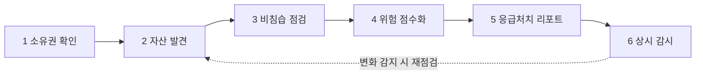

# A2D 기획서

Oct 30, 2026 · 김강현

**A2D(Attack to Defense)는 보안팀이 없는 조직을 위한 외부 노출 점검 서비스다.** 도메인을 등록하면 공격자가 약한 고리를 찾는 방법 그대로 매일 침입 없이 점검하고, 점수 하나와 "오늘 할 일 3가지"로 무엇부터 막을지 알려준다. 그 뒤에서 Attack 에이전트가 점검을 계획하고 Defense 에이전트가 결과를 쉬운 말로 풀어 준다(aid).

| 한눈에 | 내용 |
| --- | --- |
| 해커톤 주제 | 02 AI 기반 정보보호 서비스 |
| 문제 | 2026년 10월 연쇄 침해의 출발점은 노출 API, 관리도구, 방치된 파일 같은 외곽 접점이었고, 공격자는 AI로 이를 전수 탐색했다 |
| 타깃 | 여행 스타트업처럼 보안팀이 없는 회사의 IT 담당자. 대학·공공기관은 확장 대상 |
| 서비스 | 도메인 등록 → 대시보드(위험 점수, 오늘 할 일 3가지) → 응급처치 리포트 → 재점검과 새 노출 알림 |
| AI | Attack 에이전트가 추가 점검을 고르고, Defense 에이전트가 발견을 쉬운 말로 푼다. 모델은 Qwen3-8B(오픈 가중치)를 주최 측 GPU 서버에서 쓴다 |
| 안전 | 소유권을 증명한 도메인만, 읽기 전용으로 점검. AI 문장은 실제 발견과 연결돼야 리포트에 실린다 |
| 시연 | 가상 여행 플랫폼을 점검하고, 세 가지를 고친 뒤 재점검해 점수가 내려가는 것을 보여 준다 |
| 팀 | 김강현(AI·발표), 김성원(백엔드·데브옵스), 정인호(프런트엔드) |

## 이름과 한 문장

**A2D는 "공격에서 방어로(Attack to Defense)"라는 방향을 담고, 읽으면 "aid(도움)"가 된다.** 보안팀이 없는 조직에 필요한 것은 큰 솔루션이 아니라 지금 당장의 응급처치(first aid)이고, A2D가 내놓는 "오늘 할 일 3가지"가 그 응급처치다.

| 글자 | 뜻 | 서비스에서 하는 일 |
| --- | --- | --- |
| A | Attack | 공격자가 외곽 접점을 찾는 순서와 방법을 그대로 따른다 |
| 2 | to | 그 방법을 관찰만 하는 비침습 점검으로 바꾼다 |
| D | Defense | 위험 점수와 조치 우선순위로 방어 행동을 만든다 |
| 읽으면 | aid | 보안팀 없는 조직을 위한 응급처치 |

### 발표 스토리라인

1. **Attack:** 공격자는 이미 AI 에이전트로 외곽 접점을 전수 스캔한다. 2026년 10월 연쇄 침해가 그 결과다.
2. **to Defense:** 같은 방법을 방어자가 매일 쓰는 서비스로 바꾸되, 소유권을 증명한 자산만 읽기 전용으로 본다.
3. **aid:** 결과는 경고 수백 건이 아니라 점수 하나와 오늘 할 일 3가지다. 비전문가가 바로 행동할 수 있는 도움이다.

### 해커톤 주제 부합

주제 02 "개인정보와 정보자산을 보호하고 보안 위협을 탐지하고 예방하는 AI 서비스"에 대응한다. 주제 문구처럼 결과물은 에이전트가 아니라 담당자가 쓰는 서비스다. A2D는 외부 노출 자산(정보자산)을 찾고, 노출·설정 오류·알려진 취약 버전(위협)을 탐지하고, 공격자보다 먼저 조치하게 해(예방) 개인정보 유출 경로를 막는다.

## 문제 정의

**2026년 10월 한 달 동안 금융·항공·여행·대학이 연달아 뚫렸고, 침해의 출발점은 핵심 시스템이 아니라 그 옆에 붙은 외곽 접점이었다.** 공격자는 AI 자율 침투 도구로 이 접점을 전수 탐색했고, 방어자는 자기 자산 목록조차 없는 경우가 많았다.

### 10월 연쇄 침해의 출발점

| 피해 조직 | 뚫린 접점 | 규모 | 출처 |
| --- | --- | --- | --- |
| 금융회사 20곳 | 대출모집인 조회 API 인증 우회, 영업지원시스템, 외부 웹페이지 | 개인정보 약 10만 건(10월 14일, 16곳 기준) | [파이낸셜뉴스](https://www.fnnews.com/news/202610290543384323), [ASEC](https://asec.ahnlab.com/ko/96187/) |
| 항공사 | 회원정보 조회 API | 1,454명 | [뉴스피릿](https://www.newsspirit.kr/news/articleView.html?idxno=32891) |
| 가상자산 거래소 | 사내 모바일 그룹웨어 | 고객 6,444명, 임직원 715명 | 뉴스피릿 |
| 대학 | 포털 서비스 외부 비인가 접근 | 1만 5,000여 명 | 뉴스피릿 |
| 회계·ERP SW 업체 | VPN 계정, 백업 솔루션 취약점 | 사용 기업 11만 곳 이상, 민관합동조사단 | ASEC |
| 커피 프랜차이즈 | 클라우드에 방치된 임시 파일 | 약 276만 건 | ASEC |

수치는 조사가 진행 중인 사건의 보도 기준이며 매체마다 다를 수 있다. 발표 직전에 다시 확인한다.

### 공격자는 이미 AI를 쓴다

- 국내 금융권 공격에서 AI 자율 침투 도구 ARTEX의 흔적이 확인됐다. 외부에 노출된 운영 IP는 10월 14일 기준 900개를 넘었다.
- 한 공격 그룹은 표적화 후 3시간 안에 특권 접근을 얻었다. 공격은 수일이 아니라 수 시간 단위로 진행된다.
- AI 해킹 도구가 호출한 스캐너는 20분 동안 3만 2천여 건의 요청을 보냈다. [보안뉴스](https://www.boannews.com/news/articleView.html?idxno=146407)

### 방어자의 세 가지 공백

| 공백 | 현상 | 근거 |
| --- | --- | --- |
| 속도 | 공격은 시간 단위, 점검은 연 1회 | 은행 모의해킹 78건 중 AI 활용 9건(11.5%), 2026년 8월까지 [파이낸셜뉴스](https://www.fnnews.com/news/202610070845223704) |
| 가시성 | 무엇이 노출돼 있는지 모름. 테스트 서버·임시 파일·지원 종료 시스템이 방치됨 | ASEC 권고 1순위가 "외부 노출 자산 전수 목록화" |
| 해석 | 점검 결과가 있어도 무엇부터 고칠지 모름 | 금융회사 긴급 점검 555곳 중 130곳(23.4%) 미흡: 패치 미적용, 24시간 관제 미비 |

규제 산업인 금융조차 이 수준이다. 전담 보안팀이 없는 중소기업·대학·공공기관은 "우리 조직이 지금 인터넷에 무엇을, 얼마나 위험하게 노출하고 있는가"에 답할 수단이 없다. A2D가 답하려는 질문은 이것 하나다.

## 목표 사용자와 사용 시나리오

**1차 사용자는 전담 보안팀 없이 서버·도메인·위탁 서비스를 혼자 맡은 IT 담당자이고, 2차 사용자는 그 결과로 예산과 우선순위를 정하는 경영진이다.**

발표에서는 여행 스타트업의 IT 담당자 한 명을 대표 사용자로 삼는다. 10월에 여행 플랫폼도 피해를 입었고, 시연 대상인 가상 조직도 여행 플랫폼이다. 대학·공공기관은 확장 대상으로 둔다.

| 사용자 | 지금의 상황 | A2D가 주는 것 |
| --- | --- | --- |
| 중소기업·스타트업 IT 담당자 | 개발과 운영을 겸임, 점검은 연 1회 또는 없음 | 매일 자동 점검과 오늘 할 일 3가지 |
| 대학·교육기관 정보화 담당자 | 학과·연구실별로 흩어진 사이트, 자산 목록 없음 | 외부 노출 자산 자동 목록과 방치 자산 알림 |
| 경영진·행정 책임자 | 기술 보고서를 읽기 어려움 | 한 장짜리 요약과 위험 점수 추이 |

### 사용 시나리오: 보안팀 없는 여행 플랫폼

1. **등록:** IT 담당자가 회사 도메인을 입력하고 DNS 레코드로 소유권을 증명한다.
2. **발견:** A2D가 잊혀 있던 스테이징 서버, 인증 없이 회원 정보를 돌려주는 조회 API, 외부에 열린 관리자 페이지를 찾는다.
3. **응급처치:** 리포트 맨 위에 "오늘 할 일 3가지"가 나온다. 항목마다 위험한 이유, 예상 피해, 조치 방법을 쉽게 설명한다.
4. **확인:** 담당자가 API에 인증을 붙이고 재점검하면 위험 점수가 내려가고 기록에 남는다.
5. **감시:** 며칠 뒤 수탁사가 테스트 서버를 열어 두면, 공격자의 스캐너보다 먼저 "새 노출 발견" 알림이 온다.

## 서비스 개요와 핵심 기능

**사용자가 하는 일은 도메인 등록 한 번이고, 나머지는 A2D가 매일 알아서 한다.** 서비스는 네 개의 화면으로 이루어지고, 그 뒤에서 여섯 단계 점검이 돌아간다.

### 사용자가 보는 화면

| 화면 | 사용자가 하는 일 | 서비스가 보여 주는 것 |
| --- | --- | --- |
| 1. 등록 | 도메인을 입력하고 DNS 레코드로 소유권을 증명한다 | 점검 범위와 안전 원칙 안내 |
| 2. 대시보드 | 매일 아침 한 번 확인한다 | 위험 점수, 오늘 할 일 3가지, 외부 노출 자산 지도 |
| 3. 응급처치 리포트 | 항목별로 조치하고 "이거 왜 위험해요?"라고 묻는다 | 쉬운 설명, 예상 피해, 조치 방법, 접힌 기술 근거 |
| 4. 기록·알림 | 조치 후 재점검하고 경영진에게 공유한다 | 점수 추이, 새 자산·새 노출 알림, 한 장 요약 내보내기 |

### 서비스 뒤에서 매일 도는 점검

점검 결과는 점수와 응급처치 리포트로 이어지고, 감시 단계에서 변화가 감지되면 자산 발견부터 다시 돈다.

| 단계 | 하는 일 | 사용자가 얻는 것 |
| --- | --- | --- |
| 1. 소유권 확인 | DNS 레코드나 확인 파일로 소유를 증명한 도메인만 점검 대상으로 받는다 | 합법적이고 안전한 점검 범위 |
| 2. 자산 발견 | 하위 도메인, 열린 웹 서비스, API 문서, 관리자 페이지, 테스트 서버를 찾아 목록화한다 | "우리가 무엇을 노출하는가"의 첫 목록 |
| 3. 비침습 점검 | 읽기 전용 요청으로 노출 파일, 인증 없는 API, 열린 관리도구, 보안 설정, 알려진 취약 버전을 확인한다 | 공격자가 먼저 볼 약한 고리 |
| 4. 위험 점수화 | 노출도, 악용 용이성, 데이터 민감도, 자산 중요도로 점수를 계산하고 산식을 공개한다 | 무엇부터 막을지의 순서 |
| 5. 응급처치 리포트 | 한 장 요약과 "오늘 할 일 3가지"를 비전문가 언어로 쓰고, 기술 근거는 접어 둔다 | 읽고 바로 행동할 수 있는 도움 |
| 6. 상시 감시 | 매일 재점검해 새 자산·새 노출·점수 변화만 알리고, 조치 후 개선을 기록한다 | 연 1회가 아닌 매일의 점검 |

## AI 활용과 직접 개발 범위

**AI 에이전트는 결과물이 아니라 서비스 안의 엔진이다.** 사용자는 에이전트를 직접 다루지 않고, 에이전트는 점검 계획·응급처치 설명·질의응답 세 곳에서 일한다. 점검 실행과 점수 계산은 팀이 직접 만든 코드가 맡아, LLM이 멈춰도 점검·점수·기본 리포트는 동작한다.

| 에이전트 | 역할 | 통제 방법 |
| --- | --- | --- |
| Attack: 점검 계획 | 기본 점검 결과를 보고 더 파고들 곳과 순서를 고른다 | 미리 정의한 읽기 전용 점검만 호출하고, URL이 아닌 자산 ID만 넘길 수 있다 |
| Defense: 응급처치 설명 | 발견을 비전문가 언어의 이유·피해·조치로 바꾼다 | 점검 권한이 없고, 실제 발견과 연결되지 않은 문장은 리포트에서 빠진다 |
| Defense: 담당자 질의응답 | "이거 왜 위험해요?"에 답한다 | 답변마다 근거가 된 발견을 함께 보여 준다 |

두 에이전트의 이름은 A2D의 A와 D에서 왔다. Attack은 찾고, Defense는 고치게 돕는다.

### 직접 개발과 외부 자원

- **직접 개발:** 자산 발견, 비침습 점검, 위험 점수 산식, 근거 검증, 변화 감지, 대시보드, 시연용 가상 조직.
- **외부 자원:** LLM(Qwen3-8B, vLLM), 웹 프레임워크와 네트워크 라이브러리, 공개 취약점 정보. 모두 발표자료의 외부 자원 활용 내역에 기재한다.
- **모델 선택:** 점검 결과가 외부로 나가지 않도록 주최 측 GPU 서버의 오픈 가중치 모델 Qwen3-8B를 쓴다. GPU 서버는 11월 1일 13시에 삭제되므로, 11월 1일 이후의 시연은 시연 영상으로 대신하고, LLM 없는 기본 리포트는 어느 경우에도 준비한다.

세부 구조와 기술 스택은 팀이 구현하며 확정하고, 발표자료에는 실제로 만든 범위만 적는다.

점검 항목, 위험 점수 공식, LLM 선택, 도구 호출 설계는 [A2D_상세설계.md](A2D_상세설계.md)에 정리했다.

## 차별점

**기존 제품은 보안팀이 있는 조직의 도구이고, A2D는 보안팀이 없는 조직의 담당자가 혼자 읽고 조치하는 서비스다.**

| 비교 대상 | 강점 | 남는 빈칸 |
| --- | --- | --- |
| 국내 AI 모의해킹 ([티오리 진트](https://zdnet.co.kr/view/?no=20260815191653)) | 비즈니스 로직 취약점까지 검증하는 깊이, 금융권 레퍼런스 | 결과물의 독자가 보안 전문가 |
| 해외 자율 모의해킹 ([NodeZero, XBOW, Pentera 등](https://securityboulevard.com/2026/08/horizon3-ai-alternatives-in-2026-escape-vs-nodezero-and-4-more-tools/)) | 네트워크·웹·API 침투 깊이 | 견적 또는 연 3만 5천 달러부터(Pentera), 보안팀이 있는 조직 대상 |
| 정부 무상 점검 ([과기정통부·KISA](http://www.boannews.com/news/articleView.html?idxno=144335)) | 비용 없음, 중소기업 누구나 신청 | 신청할 때만 점검해 그 사이의 변화를 못 본다 |
| 전통 취약점 스캐너 | 넓은 점검 항목 | 경고 수백 건을 그대로 내놓아 우선순위를 잡기 어렵다 |

### A2D만의 세 가지

1. **응급처치 리포트:** 점수 하나와 오늘 할 일 3가지. 전문 용어는 접어 둔 근거에만 나온다.
2. **근거 검증:** AI가 쓴 문장은 실제 발견에 연결돼야만 리포트에 실린다. 없는 취약점을 지어내지 않는다.
3. **상시 감시:** 점검과 점검 사이의 빈틈을 메운다. 정부 무상 점검과 경쟁하지 않고 보완한다.

## 안전·신뢰 설계

**이름에 Attack이 들어가는 만큼, "내 것임을 증명한 대상만 읽기 전용으로 본다"는 원칙을 기능 안에 넣는다.** 같은 기술이 공격에도 쓰이므로, 악용할 수 없는 구조 자체가 서비스의 신뢰 근거다.

| 원칙 | 방법 | 이유 |
| --- | --- | --- |
| 소유권 검증 | 소유를 증명하지 않은 도메인은 점검하지 않는다 | 정보통신망법 제48조는 정당한 권한 없는 침입을 금지한다 |
| 읽기 전용 | 데이터를 바꾸거나 계정을 추측하거나 공격 코드를 넣는 기능이 없다 | AI 점검 도구가 실험 데이터를 삭제한 사례가 보고됐다 |
| 부하 제한 | 대상별 요청 속도를 제한하고 언제든 멈출 수 있다 | 점검이 서비스 장애를 일으키면 안 된다 |
| 개인정보 비수집 | 개인정보가 노출된다는 사실만 기록하고 내용은 가려서 보관한다 | 점검 도구가 유출 경로가 되면 안 된다 |
| 근거 검증 | 실제 발견과 연결되지 않은 AI 문장은 삭제하고, 발견마다 확실성 등급을 붙인다 | 없는 위험을 보고하면 담당자의 시간과 신뢰를 잃는다 |
| 조치는 사람이 | A2D는 권고만 하고 설정 변경은 담당자가 한다 | 금보원 AI 에이전트 평가기준(안)도 도구 실행 승인과 자율 실행 제한을 점검한다 |

대회 기간의 점검과 시연은 팀이 만든 가상 조직만 대상으로 하고, 그 안의 개인정보는 모두 가상 데이터로 만든다.

## MVP 범위와 시연 흐름

**MVP의 기준은 "발견 → 응급처치 리포트 → 조치 → 재점검 → 점수 하락"이 한 번에 이어지는가다.** 기능 수보다 이 한 흐름의 완성도를 우선한다.

### 범위

- **포함(서비스 화면):** 등록·소유권 확인, 대시보드(점수, 오늘 할 일 3가지, 자산 지도), 응급처치 리포트와 질의응답, 재점검 기록, 대시보드 안의 새 노출 알림, 한 장 요약 내보내기.
- **포함(엔진):** 자산 발견, 비침습 점검, 위험 점수, 근거 검증, LLM 없는 기본 리포트.
- **포함(시연 환경):** 설정이 일부러 잘못된 가상 여행 플랫폼. 잊힌 스테이징 서버, 인증 없는 회원 조회 API, 열린 관리자 페이지, 방치된 백업 파일 등을 담는다.
- **제외:** 회원가입·결제·여러 조직 관리, 실제 외부 도메인 점검, 클라우드 계정·위탁 연결 점검, 메일·메신저 알림 연동. 한 조직이 쓰는 흐름 하나만 완성하고 나머지는 확장 로드맵으로 넘긴다.
- **원칙:** 11월 1일 13시 제출 시점에 실제로 동작하는 것만 발표자료에 "구현"으로 적고, 나머지는 "계획"으로 적는다.

### 시연 흐름 (3분)

1. **0:00 문제:** "보안팀 없는 여행 플랫폼입니다." 도메인을 등록하고 소유권을 확인한다.
2. **0:30 Attack:** 자산이 발견되고 점검이 진행된다. 공격자가 먼저 볼 약한 고리가 드러난다.
3. **1:20 aid:** 응급처치 리포트의 "오늘 할 일 3가지"를 읽고, 근거를 펼쳐 보인다.
4. **2:10 Defense:** 두 가지를 조치하고 재점검해 위험 점수가 내려가는 것을 보인다.
5. **2:40 감시:** 새 테스트 서버를 열면 알림이 온다. "공격자보다 먼저 봅니다."

시연 환경은 노트북 한 대에서 외부 연결 없이 돌아가게 하고, 같은 환경을 두 번째 노트북에 준비한다. 1차 제출용 2분 영상과 11월 1일 이후 발표용 시연 영상 모두 이 순서로 녹화한다.

## 기대효과와 확장 로드맵

**A2D가 바꾸는 것은 두 가지다. 점검 주기는 연 1회에서 매일로, 결과물의 독자는 전문가에서 담당자로.** 제품 자체의 효과 수치는 시연 환경에서 측정한 뒤에만 쓴다.

| 구분 | 지금 | A2D 이후 |
| --- | --- | --- |
| 점검 주기 | 연 1회 외부 점검 또는 없음 | 매일 자동 재점검, 변화 즉시 알림 |
| 자산 가시성 | 외부 노출 자산 목록이 없음 | 자동으로 만들어지는 자산 목록 |
| 결과물 | 전문가용 경고 수백 건 | 점수 하나와 오늘 할 일 3가지 |
| 의사결정 | 보안 투자 효과를 설명하기 어려움 | 경영진이 점수 추이로 판단 |

### 확장 로드맵

1. **해커톤 MVP (2026년 11월):** 가상 조직 기준으로 발견부터 재점검까지 한 흐름을 완성한다.
2. **파일럿:** 점검 항목을 늘리고 위탁 서비스·클라우드 권한 점검과 알림 연동을 더한다. 소유권을 증명한 교육기관·스타트업의 실제 도메인으로 검증한다.
3. **확산:** KISA 중소기업 무상 점검 사이 기간을 메우는 상시 서비스로 연계한다. 금보원 AI 에이전트 보안 평가기준(2027년 정식 도입 예정)에 맞춘 자체 평가를 갖추고, 조직 간 익명 위협정보 공유로 넓힌다.

수익 모델은 조직당 월 구독과 공공·교육기관 바우처 연계를 가설로 두고, 파일럿에서 검증한다.

## 팀 구성과 추진 일정

**역할은 결과물 단위로 나누고, 각자 발표자료의 한 항목을 책임진다.** 2차 발표는 김강현이 설명하고 정인호가 발표용 시연 영상을 만들며, 질의응답은 각자 맡은 영역을 답한다.

| 이름 | 역할 | 맡는 일 |
| --- | --- | --- |
| 김강현 | AI·기획·발표 | Attack·Defense 에이전트, 프롬프트, 도구와 가드, 근거 검증, 모델 품질 확인, 기획서와 발표 대본, 2차 발표 |
| 김성원 | 백엔드·데브옵스 | 자산 발견과 점검 엔진, 위험 점수 공식, 서비스 API와 저장소, GPU 서버 모델 서빙, 가상 여행 플랫폼, 시연 환경과 README |
| 정인호 | 프런트엔드 | 등록·대시보드·리포트·기록 화면, 시연 영상 녹화와 편집, 발표자료 디자인, 2차 발표용 시연 영상 제작 |

### 추진 일정

| 구간 | 시작 | 끝 |
| --- | --- | --- |
| 기획·역할 분담 | 10/30 11시 | 10/30 18시 |
| 점검·점수 구현 | 10/30 18시 | 10/31 12시 |
| 에이전트·리포트 | 10/31 09시 | 10/31 22시 |
| 통합·시연 녹화 | 10/31 22시 | 11/1 09시 |
| 발표자료·제출 | 11/1 09시 | 11/1 12시 |
| **제출 마감** | 11/1 13시 | |
| 상위 10팀 발표 | 11/1 17시 | |
| 2차 대면 발표 | 11/2 13시 30분 | |

막대 옆 시각은 각 구간이 끝나는 시각이고 점선이 제출 마감이다. 멘토링 4시간은 10월 31일 기획·기술 점검 각 1시간, 11월 1일 발표자료 검토 2시간으로 쓴다.

## 위험과 대응

**가장 큰 위험은 구현 분량과 2차 라이브 시연의 LLM이다.** 나머지는 미리 대비할 수 있다.

| 위험 | 내용 | 대응 |
| --- | --- | --- |
| 구현 분량 | 3명이 50시간 안에 점검 11종, 화면 4개, 에이전트 2개를 만들기에 빠듯하다 | 줄일 순서를 미리 정했다: 질의응답 → 자산 지도 → 점검 11종을 7종으로 |
| 2차 심사의 시연 방식 | GPU 서버가 11월 1일 13시에 삭제되어 11월 1일 이후 시연은 영상으로 대신할 계획이다. 그런데 가이드는 2차 발표에 "라이브 시연 3분 이상"을 요구하고, 시연을 하지 않으면 기술 완성도가 0점이다 | 시연 영상이 라이브 시연으로 인정되는지 운영진에 먼저 확인한다. 인정되지 않으면 서버 유지 요청이나 노트북 실행을 다시 검토한다. LLM 없는 기본 리포트는 항상 준비한다 |
| 모델 품질 | 8B 모델의 한국어 설명이 충분한지 모른다 | 착수 초기에 발견 5건으로 확인하고, 부족하면 프롬프트와 조치 가이드 문장을 보강한다 |
| 규정 위반 | 외부 자원을 빠뜨리면 실격이다 | 제출 전 외부 자원 표를 실제 의존성과 대조하고, AI 도구 기재 방법을 운영진에 확인한다 |
| 시연 안정성 | 녹화 중 오류, 영상 화질 | 녹화 전 시나리오를 두 번 리허설하고, 1080p로 녹화한다 |

## 출처

- [AhnLab ASEC, "AI가 찾아낸 약한 고리: 외곽 접점이 무너진 2026년 10월" (2026.10.29)](https://asec.ahnlab.com/ko/96187/)
- [뉴스피릿, "국가 해킹 비상사태…10월에만 금융·항공·여행·대학까지 뚫렸다" (2026.10.30)](https://www.newsspirit.kr/news/articleView.html?idxno=32891)
- [파이낸셜뉴스, "금융사 4곳 중 1곳 보안 '미흡'" (2026.10.29)](https://www.fnnews.com/news/202610290543384323)
- [파이낸셜뉴스, "취약점 드러난 금융권 AI 에이전트 보안" (2026.10.7)](https://www.fnnews.com/news/202610070845223704)
- [보안뉴스, 티오리 '아르텍스' 분석 백서 기사 (2026.10.15)](https://www.boannews.com/news/articleView.html?idxno=146407)
- [보안뉴스, "정부, 중소기업 공격표면 무료 점검" (2026.6.26)](http://www.boannews.com/news/articleView.html?idxno=144335)
- [ZDNet Korea, 티오리 '진트' IDC 이노베이터 선정 (2026.8.15)](https://zdnet.co.kr/view/?no=20260815191653)
- [Security Boulevard, "Horizon3.ai alternatives in 2026" (2026.8.20)](https://securityboulevard.com/2026/08/horizon3-ai-alternatives-in-2026-escape-vs-nodezero-and-4-more-tools/)
- 코디세이 AI 해커톤 2026 참가자 가이드(2026.10.13), GPU/서버 사용 가이드
