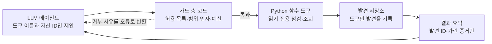

# A2D 상세 설계

**A2D의 점검은 정해진 목록을 빠짐없이 돌리는 코드와, 그 결과를 보고 더 파고들 곳을 고르는 LLM의 두 층으로 설계한다.** LLM이 점검을 빠뜨려도 기본 점검은 빠지지 않고, LLM은 발견을 만들 수 없으며 오직 도구만 발견을 기록한다. 아래 수치와 목록은 팀이 구현하며 조정하는 초기값이다.

## 1. 점검 항목

**자산 발견 5종으로 대상을 찾고, 점검 17종 중 11종을 MVP에서 구현한다.** 모든 항목은 읽기 전용 요청으로 판정하고, 10월 사고에서 실제로 뚫린 유형을 우선했다.

### 자산 발견 (점수에 들어가지 않음)

| ID | 항목 | 방법 | MVP |
| --- | --- | --- | --- |
| D-01 | 하위 도메인 수집 | 인증서 투명성 로그와 DNS 조회, 흔한 이름(www, api, admin, dev, staging 등 30개 안팎) 확인 | O |
| D-02 | 웹 서비스 확인 | 웹 포트(80, 443, 8080, 8443)에 HTTP 요청 1회. 전체 포트 스캔은 하지 않는다 | O |
| D-03 | 기술 식별 | 응답 헤더(Server, X-Powered-By)와 페이지 흔적으로 제품·버전 추정 | O |
| D-04 | API 문서 탐지 | /swagger, /openapi.json, /api-docs 등의 존재 확인 | O |
| D-05 | 관리 경로 탐지 | /admin, /manager 등 20개 안팎 경로의 응답 코드 확인 | O |

### 점검 항목

| ID | 항목 | 확인 방법 | 위험 판정 | 기본 심각도 | 확실성 | MVP |
| --- | --- | --- | --- | --- | --- | --- |
| C-01 | 백업 파일 노출 | 웹 루트의 흔한 백업 파일명(backup.zip, db.sql 등) 요청 | 200 응답이고 파일 서명(압축·SQL)이 맞음 | 치명 | 확인됨 | O |
| C-02 | 설정·소스 노출 | /.env, /.git/HEAD 등 요청 | 200 응답이고 형식이 일치 | 치명 | 확인됨 | O |
| C-03 | 디렉터리 목록 노출 | 발견된 경로의 응답 본문 | 파일 목록 페이지가 열림 | 보통 | 확인됨 | 확장 |
| C-04 | 로그·디버그 정보 노출 | 로그 경로, 디버그 페이지, 오류 응답 | 로그 내용이나 스택 트레이스가 보임 | 높음 | 확인됨 | O |
| C-05 | 인증 없는 개인정보 API | API 문서에 적힌 조회형 엔드포인트를 인증 없이 1회 호출. 번호를 바꿔 가며 반복 조회하지 않는다 | 200 응답에 이메일·전화번호 패턴 | 치명 | 확인됨 | O |
| C-06 | API 문서 공개 | D-04 결과 | 인증 없이 문서 열람 가능 | 보통 | 확인됨 | O |
| C-07 | 관리 페이지 외부 노출 | D-05 결과 | 관리자 로그인 화면이 인터넷에서 열림 | 높음 | 확인됨 | O |
| C-08 | 로그인 평문 전송 | 로그인 폼의 제출 주소 | http로 제출되거나 https 전환이 없음 | 높음 | 확인됨 | 확장 |
| C-09 | TLS 인증서·프로토콜 | TLS 연결 수립 | 만료, 30일 내 만료, 자체 서명, TLS 1.0·1.1 허용 | 보통 | 확인됨 | O |
| C-10 | 보안 헤더 누락 | 응답 헤더 | HSTS, CSP, X-Frame-Options, X-Content-Type-Options 없음 | 낮음 | 확인됨 | O |
| C-11 | 세션 쿠키 속성 | Set-Cookie 헤더 | Secure·HttpOnly·SameSite 없음 | 낮음 | 확인됨 | 확장 |
| C-12 | CORS 과허용 | Origin 헤더를 바꿔 1회 요청 | 임의 Origin을 돌려주고 자격증명도 허용 | 보통 | 확인됨 | 확장 |
| C-13 | 알려진 취약 버전 | D-03 버전을 오프라인 취약 버전 목록과 대조 | 목록의 영향 범위에 포함 | CVSS로 결정 | 가능성 | O |
| C-14 | 지원 종료 소프트웨어 | D-03 버전을 지원 종료 목록과 대조 | 지원이 끝난 버전 | 높음 | 가능성 | 확장 |
| C-15 | 잊힌 자산 | D-01 결과의 이름 | dev·staging·test·old 등이 외부에서 열림 | 보통 | 확인됨 | O |
| C-16 | 새 자산·새 노출 | 직전 점검과 비교 | 새 하위 도메인, 새 경로, 새 발견 | 알림 전용 | 확인됨 | O |
| C-17 | 메일 위조 방지 미설정 | DNS TXT 조회 | SPF·DMARC가 없거나 정책이 none | 낮음 | 확인됨 | 확장 |

확실성은 세 단계다. "확인됨"은 응답으로 직접 확인한 경우, "가능성"은 버전 표시처럼 간접 증거만 있는 경우, "확인 필요"는 사람이 내부에서 확인해야 하는 경우다.

### 10월 사고와의 연결

- **C-05:** 항공사 회원정보 조회 API, 금융권 대출모집인 조회 서비스.
- **C-01, C-04:** 클라우드에 남은 임시 파일, 로그 파일에 남은 개인정보.
- **C-07:** 외부에서 접근된 그룹웨어·영업지원시스템.
- **C-13, C-14:** PHP2Shell 같은 N-day 취약점, 점검에서 지적된 기술지원 종료 시스템.
- **C-15, C-16:** 방치된 테스트 서버와 수탁사가 열어 둔 자산.

### 모든 점검에 공통인 안전 제한

- **대상:** 소유권 확인을 통과한 도메인과 그 하위 자산만. 다른 도메인으로 넘어가는 리디렉션은 따라가지 않는다.
- **방법:** GET과 HEAD만 쓴다. 쓰기 요청, 로그인 시도, 입력값 조작은 하지 않는다.
- **속도:** 대상 호스트당 초당 2건, 점검 1회당 300건 상한, 요청마다 10초 제한.
- **증거 보관:** 응답은 앞부분 512바이트만 저장하고, 이메일·전화번호는 가려서 저장한다.
- **식별:** 모든 요청에 A2D 점검임을 밝히는 User-Agent를 붙인다.

## 2. 위험 점수 계산

**점수는 발견 → 자산 → 조직 순서로 0\~100 사이에서 계산하고, 조직 점수는 가장 약한 자산의 점수다.** 계산은 전부 코드가 하고 LLM은 관여하지 않는다. 산식은 화면에 그대로 공개한다.

### 발견 점수

```latex
f = 100 \times S \times E \times X \times C
```

| 요소 | 뜻 | 값 |
| --- | --- | --- |
| S 심각도 | 점검 항목의 기본 심각도 | 치명 1.0, 높음 0.75, 보통 0.5, 낮음 0.25. C-13은 CVSS 9.0 이상 1.0, 7.0\~8.9 0.75, 4.0\~6.9 0.5, 그 아래 0.25 |
| E 노출도 | 인터넷에서 얼마나 쉽게 닿는가 | 인증 없이 열림 1.0, 로그인·IP 제한 뒤(401·403 응답) 0.5 |
| X 악용 용이성 | 발견 뒤 악용에 드는 노력 | 바로 내려받기·조회 가능하거나 공개 공격 코드·실제 악용 보고가 있음 1.0, 추가 조건 필요 0.7, 이론적 0.4 |
| C 확실성 | 증거의 강도 | 확인됨 1.0, 가능성 0.7, 확인 필요 0.4 |

### 자산 점수

```latex
R_j = 100 \times A_j \times \left(1 - \prod_{i \in j} \left(1 - \frac{f_i}{100}\right)\right)
```

- 한 자산의 발견이 여럿이면 위험이 쌓이되 100을 넘지 않는다. 심각한 발견 하나만 있어도 점수는 높다.
- A는 자산 중요도다. 개인정보·결제를 다루면 1.0, 내부 업무용이면 0.8, 정적·홍보용이면 0.5다. 발견 단계의 단서(로그인·회원·결제 경로)로 기본값을 정하고, 담당자가 화면에서 고칠 수 있다.

### 조직 점수와 등급

```latex
R_{org} = \max_j R_j
```

공격자는 가장 약한 고리 하나만 있으면 되므로 최댓값을 쓴다. 대시보드에는 위험 등급 이상인 자산 수를 함께 보여 준다.

| 점수 | 등급 |
| --- | --- |
| 70\~100 | 심각 |
| 40\~69 | 위험 |
| 20\~39 | 주의 |
| 0\~19 | 양호 |

### 오늘 할 일 3가지 고르기

1. 남은 발견마다 "이것을 고치면 조직 점수가 얼마나 내려가는가"를 계산한다.
2. 가장 많이 내리는 발견을 고른다. 같으면 그 자산 점수가 더 내려가는 것, 그다음 조치 시간이 짧은 것을 고른다.
3. 고른 발견을 고쳤다고 보고 1\~2를 두 번 더 반복한다.

조치 시간은 점검 항목별로 팀이 정한 표준값을 쓴다. 그래서 "오늘 할 일"은 LLM이 고르지 않고, LLM은 고른 항목을 설명하기만 한다.

### 계산 예시 (시연용 가상 조직의 설계값)

| 발견 | 자산 (A) | S | E | X | C | f |
| --- | --- | --- | --- | --- | --- | --- |
| C-05 인증 없는 회원 조회 API | api (1.0) | 1.0 | 1.0 | 1.0 | 1.0 | 100 |
| C-01 백업 파일 노출 | staging (0.8) | 1.0 | 1.0 | 1.0 | 1.0 | 100 |
| C-13 취약 버전 표시, CVSS 9.2 | www (0.5) | 1.0 | 1.0 | 1.0 | 0.7 | 70 |
| C-07 관리 페이지 외부 노출 | admin (0.8) | 0.75 | 1.0 | 0.7 | 1.0 | 52.5 |
| C-10 보안 헤더 누락 | www (0.5) | 0.25 | 1.0 | 0.4 | 1.0 | 10 |

- 자산 점수는 api 100, staging 80, admin 42, www 36.5다. www는 1 − (1 − 0.7) × (1 − 0.1) = 0.73에 중요도 0.5를 곱한 값이다.
- 조직 점수는 100(심각)이다.
- 오늘 할 일은 C-05, C-01, C-07 순서다. 하나씩 고칠 때마다 조직 점수는 100 → 80 → 42 → 37로 내려간다.
- 시연에서는 이 하락을 재점검으로 보여 준다. 실제 발표 수치는 구현 후 측정값으로 바꾼다.

## 3. LLM 선택과 역할

**모델은 Qwen3-8B(오픈 가중치, Apache 2.0) 하나로 정하고, 주최 측 GPU 서버에서 vLLM으로 서빙한다.** GPU 서버는 11월 1일 13시에 삭제될 예정이므로, 11월 1일 이후의 시연은 서버가 있을 때 녹화한 시연 영상으로 대신한다. 모델 호출부는 한 곳에 모아 서빙 위치를 설정값 하나로 바꿀 수 있게 둔다.

### 모델 구성

| 구분 | 모델·도구 | 위치 | 비고 |
| --- | --- | --- | --- |
| 기본 | Qwen3-8B (BF16), vLLM 서빙 | 주최 측 GPU 서버 (NVIDIA L4, 23GB) | 도구 호출 지원. 문맥 길이를 8천\~1만 6천 토큰으로 제한해 메모리에 맞춘다 |
| 예비 | LLM 없는 템플릿 리포트 | 서비스 내부 | 모델이 응답하지 않아도 점검·점수·기본 리포트가 동작한다 |

Qwen3-8B를 고른 이유는 세 가지다. 도구 호출을 지원하고, 상업 이용이 가능한 Apache 2.0 라이선스이며, 23GB GPU 한 장에 들어간다. 한국어 설명 품질은 착수 초기에 발견 5건으로 확인하고, 부족하면 Defense의 프롬프트와 조치 가이드 문장을 보강한다.

### 역할별 설정

| 에이전트 | 역할 | 입력 | 출력 | 설정 |
| --- | --- | --- | --- | --- |
| Attack | 점검 계획 | 자산 목록과 기본 점검 결과 요약 | 추가 점검 도구 호출 | 점검 도구만 허용, 1회 실행당 도구 호출 20회 상한 |
| Defense | 응급처치 설명 | 오늘 할 일 3개의 발견, 가린 증거, 팀이 쓴 조치 가이드 | 정해진 JSON 형식의 리포트 항목 | 조회 도구만 허용, 항목마다 발견 ID 필수 |
| Defense | 질의응답 | 담당자 질문 | 근거 발견이 붙은 답 | 조회 도구만 허용, 점검 실행 불가 |

### LLM에 보내는 것과 보내지 않는 것

- **보낸다:** 발견 ID, 점검 항목 ID, 자산 별칭, 점수 요소, 가린 증거 발췌(200자 이내).
- **보내지 않는다:** 응답 원문, 개인정보, 파일 내용, 인증정보.
- **프롬프트 주입 방지:** 점검 대상 서버의 응답에는 악의적인 문장이 들어 있을 수 있다. 증거는 "읽기만 하는 데이터"로 표시해 넣고, 설령 지시를 따르더라도 가드 층이 허용되지 않은 호출을 막는다.
- **시스템 프롬프트 원칙:** 독자는 보안 비전문가다. 발견 ID 없는 주장과 새로운 취약점 추측은 금지한다. 조치는 팀이 쓴 가이드 범위에서만 안내한다.

## 4. 도구 호출 설계

**LLM은 Python 함수로 만든 도구만 호출할 수 있고, 모든 호출은 코드로 만든 가드 층을 거쳐 실행된다.** LLM에는 URL을 받는 도구가 없고 자산 ID만 넘길 수 있어, 어떤 지시를 받아도 소유권이 확인된 범위 밖을 점검할 수 없다.


예산이 끝나거나 finish_scan을 호출할 때까지 반복한다.

LLM은 도구를 제안만 하고, 실행 여부는 가드가 정한다. 도구 결과는 발견 ID와 가린 증거로만 돌아가므로 응답 원문은 LLM에 닿지 않는다.

### 점검 1회의 실행 순서

1. **기본 점검 (코드):** 자산 발견 5종과 MVP 점검을 정해진 순서로 모두 실행한다. LLM 없이 돈다.
2. **추가 점검 (Attack 에이전트):** LLM이 기본 결과를 보고 더 볼 곳을 고른다. API 문서가 나오면 조회형 엔드포인트마다 C-05를, 버전이 보이면 C-13을 호출하는 식이다.
3. **점수와 오늘 할 일 (코드):** 2절의 공식과 선정 절차를 적용한다.
4. **응급처치 설명 (Defense 에이전트):** LLM이 조회 도구로 근거를 읽고 submit\_report로 리포트를 제출한다.
5. **근거 검증 (코드):** 통과한 항목만 화면에 나간다. 실패하면 이유를 알려 한 번 더 요청하고, 두 번째도 실패하면 템플릿 문장으로 바꾼다.

### Python 함수 도구 목록

| 도구 | 쓰는 에이전트 | 하는 일 | 입력 | 반환 |
| --- | --- | --- | --- | --- |
| list\_assets | Attack | 소유권이 확인된 자산과 태그 조회 | 없음 | 자산 ID, 별칭, 태그, 기본 점검 요약 |
| probe\_http | Attack | D-02·D-03 다시 확인 | asset\_id | 상태 코드, 주요 헤더, 추정 제품·버전, API 엔드포인트 ID |
| check\_paths | Attack | C-01·C-02·C-04·C-07 경로 묶음 점검 | asset\_id, category(backup·config·logs·admin) | 발견 ID 목록 |
| check\_unauth\_api | Attack | C-05 | asset\_id, endpoint\_id | 발견 ID 또는 이상 없음 |
| check\_tls\_headers | Attack | C-09·C-10 | asset\_id | 발견 ID 목록 |
| lookup\_known\_vulns | Attack | C-13, 오프라인 목록 대조 | asset\_id | 발견 ID, CVE, CVSS |
| finish\_scan | Attack | 추가 점검 종료 | reason | 없음 |
| get\_findings | Defense | 발견 조회 | asset\_id(선택), min\_score(선택) | 발견 요약 목록 |
| get\_evidence | Defense | 가린 증거 조회 | finding\_id | 200자 이내 발췌 |
| get\_score\_breakdown | Defense | 점수 요소 조회 | finding\_id | S·E·X·C, 발견·자산·조직 점수 |
| get\_fix\_guide | Defense | 팀이 쓴 조치 가이드 | check\_id | 조치 단계, 표준 조치 시간 |
| simulate\_fix | Defense | 고치면 점수가 어떻게 변하는지 | finding\_ids | 조치 후 조직 점수 |
| submit\_report | Defense | 리포트 제출 | items | 근거 검증 결과 |

도구는 타입 힌트가 붙은 Python 함수로 만들고, 입력 스키마는 함수 정의에서 만든다(Pydantic 모델 후보). 도구마다 쓸 수 있는 에이전트를 등록해 두고, 에이전트에는 자기 도구만 보여 준다. 점검 도구는 발견을 저장소에 직접 기록하고 발견 ID만 돌려준다.

### 가드 규칙 (코드가 강제)

- **허용 목록:** 에이전트별로 허용된 도구만 실행한다. Defense 에이전트는 점검을 실행할 수 없다.
- **범위:** asset\_id는 소유권이 확인된 자산만, endpoint\_id는 발견된 API 문서의 조회형 엔드포인트만 받는다.
- **인자 검증:** 스키마에 맞지 않으면 실행하지 않고 오류 결과를 돌려준다.
- **예산:** 실행 1회당 도구 호출 20회, HTTP 요청 300건, 제한 시간 5분. 넘으면 추가 점검을 멈추고 있는 결과로 진행한다.
- **중복 방지:** 같은 도구를 같은 인자로 다시 부르면 저장된 결과를 돌려준다.
- **감사 기록:** 모든 호출의 시각, 도구, 인자, 결과 요약, 거부 사유를 남기고 화면에서 볼 수 있게 한다.

### 도구 정의 예시

```json
{
  "name": "check_unauth_api",
  "description": "API 문서에서 발견된 조회형(GET) 엔드포인트 하나를 인증 없이 한 번 호출해 개인정보가 응답되는지 확인한다. 번호를 바꿔 가며 반복 호출하지 않는다.",
  "strict": true,
  "input_schema": {
    "type": "object",
    "properties": {
      "asset_id": {"type": "string", "description": "list_assets가 돌려준 자산 ID"},
      "endpoint_id": {"type": "string", "description": "probe_http가 돌려준 API 엔드포인트 ID"}
    },
    "required": ["asset_id", "endpoint_id"],
    "additionalProperties": false
  }
}
```

반환 예시는 다음과 같다. 개인정보 자체는 LLM에 넘기지 않는다.

```json
{"status": "finding", "finding_id": "F-0012", "check_id": "C-05", "confidence": "확인됨", "evidence": "200 응답, 이메일 형식 3건 포함(가림)"}
```

submit\_report의 항목은 finding\_ids(1개 이상), 제목, 왜 위험한가, 예상 피해, 조치 방법, 예상 조치 시간(분)을 모두 필수로 받는다.

### 근거 검증 규칙

1. 항목의 finding\_ids가 모두 실제로 있고, 오늘 할 일 3가지에 들어 있다.
2. 문장에 나온 자산 이름, 점검 항목, 점수, 조치 시간이 발견 데이터와 일치한다.
3. CVE 번호는 그 발견의 증거에 있는 것만 허용한다.
4. 조치 방법에 가이드에 없는 명령어나 설정 이름이 나오면 실패로 본다.
5. 화면에는 "근거 검증 통과 3/3"처럼 결과를 표시한다.

## 5. 팀이 정해야 할 것

- [x] 모델: Qwen3-8B, GPU 서버에서 vLLM 서빙 (10월 30일)
- [x] 에이전트 구성: Attack·Defense 두 에이전트 (10월 30일)
- [x] 발표 타깃: 여행 스타트업의 IT 담당자 (10월 30일)
- [x] 점수 공식: 이 문서의 초기값 유지 (10월 30일)
- [x] 11월 1일 이후 시연: 시연 영상으로 대신 (10월 31일)
- [ ] 운영진 확인: 2차 심사에서 시연 영상이 라이브 시연으로 인정되는지, AI 코딩 도구 사용 기재 방법
- [ ] 발표용 시연 영상 녹화: GPU 서버 삭제(11월 1일 13시) 전에 마칠 것
- [ ] 자산 중요도 기본값 규칙과 점검 항목별 표준 조치 시간표
- [ ] 오프라인 취약 버전 목록에 넣을 제품 (시연 환경 기준 10개 안팎)
- [ ] 시연용 가상 조직의 결함을 MVP 점검 11종과 맞추기
- [ ] 외부 자원 표에 반영: Qwen3-8B(Apache 2.0), vLLM, Pydantic
