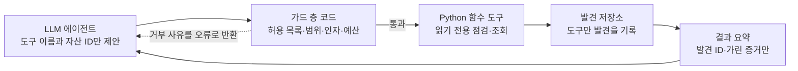

# A2D 상세 설계

**A2D의 점검은 정해진 목록을 빠짐없이 돌리는 코드와, 그 결과를 보고 더 파고들 곳을 고르는 LLM의 두 층으로 설계한다.** LLM이 점검을 빠뜨려도 기본 점검은 빠지지 않고, LLM은 발견을 만들 수 없으며 오직 도구만 발견을 기록한다. 아래 수치와 목록은 팀이 구현하며 조정하는 초기값이다.

## 1. 점검 항목

**점검 항목 34개(1차 29개)와 항목별 판정 조건은 [A2D_점검점수설계.md](A2D_점검점수설계.md)가 기준이다.** 이 절은 구현 범위와 공통 제한만 정리하고, 번호는 그 문서의 #1\~#34를 그대로 쓴다. 모든 항목은 읽기 전용 요청으로 판정한다.

### 1차 구현 범위

| 분류 | 자산 찾기 (점수 미반영) | 1차 점검 (점수 반영) | 1차·식별 | 2차 |
| --- | --- | --- | --- | --- |
| A. 자산 찾기 | #1\~#5 | #6 | | #7 |
| B. 노출된 파일·정보 | | #8\~#14 | | #15 |
| C. 접근 통제 | | #16\~#21, #34 | | #22 |
| D. 소프트웨어 버전 | | #23, #25 | #24 | |
| E. 전송·브라우저 설정 | | #26\~#28, #30, #31 | | #29 |
| F. 메일·도메인 | | #32, #33 | | |

1차는 자산 찾기 5종과 점검 24종을 합친 29종이고, #24는 자산 정보에 표시만 한다. 시간이 모자라면 시연 대상에 심은 결함 항목부터 구현한다.

확실성(신뢰도)은 세 단계다. "확인됨"은 응답으로 직접 확인한 경우, "가능성"은 버전 표시처럼 간접 증거만 있는 경우, "확인 필요"는 사람이 내부에서 확인해야 하는 경우다.

### 변화 감지 (점검 항목 아님)

직전 점검과 비교해 새 하위 도메인, 새 경로, 새 발견, 해결된 발견을 표시한다. 점수에는 들어가지 않고 대시보드 알림(FR-15)과 기록(FR-10)에 쓴다.

### 10월 사고와의 연결

- **#16:** 항공사 회원정보 조회 API, 금융권 대출모집인 조회 서비스.
- **#8, #14:** 클라우드에 남은 임시 파일.
- **#18:** 외부에서 접근된 그룹웨어·영업지원시스템.
- **#23, #25:** PHP2Shell 같은 N-day 취약점, 점검에서 지적된 기술지원 종료 시스템.
- **#1, #4, #5, #19:** 방치된 테스트 서버와 수탁사가 열어 둔 자산.

### 모든 점검에 공통인 안전 제한

- **대상:** 소유권 확인을 통과한 도메인과 그 하위 자산만. 클라우드 저장소·백엔드 대행 서비스 같은 외부 주소는 우리 사이트나 DNS가 직접 가리키는 것만 점검하고, 이름을 추측하지 않는다. 다른 도메인으로 넘어가는 리디렉션은 따라가지 않는다.
- **단서 경로:** 추가 점검은 대상이 스스로 공개한 내용(`robots.txt`의 `Disallow` 경로, 화면 코드·소스맵에 나온 경로, API 문서의 경로)에 있는 경로만 요청한다. `robots.txt`의 금지 경로는 검색엔진에 보내는 요청이라 소유권을 확인한 도메인에서는 따라간다. 경로를 추측하거나 단어 목록으로 대입하지 않는다.
- **방법:** HTTP GET·HEAD, DNS 조회, TLS 연결, 공개 등록 정보·인증서 발급 기록 조회만 쓴다. #21은 `Origin` 헤더만 바꾼다. 쓰기 요청, 로그인 시도, 입력값 조작은 하지 않는다.
- **속도:** 대상 호스트당 초당 2건, 점검 1회당 300건 상한, 요청마다 10초 제한.
- **증거 보관:** 응답 원문은 저장하지 않고, 앞부분 512바이트나 가린 발췌만 저장한다. 이메일·전화번호는 가리고, 비밀키는 앞 4글자만, 버킷 파일 이름은 가려서 저장한다.
- **외부 조회:** 인증서 발급 기록(crt.sh, 실패 시 Certspotter)과 도메인 등록 정보(RDAP)에는 도메인 이름만 보낸다. 지원 종료 일정(endoflife.date)과 취약 버전 목록은 내장해 둔다. 시연 환경에서는 외부 연결 없이 샌드박스의 가짜 응답을 쓴다.
- **식별:** 모든 요청에 A2D 점검임을 밝히는 User-Agent를 붙인다.

## 2. 위험 점수 계산

**계산식, 4요소 기준, 항목별 기본값은 [A2D_점검점수설계.md](A2D_점검점수설계.md) 2절이 기준이다.** 발견마다 위험 점수를 내고, 이를 모아 조직의 안전 점수와 A\~F 등급을 낸다. 계산은 전부 코드가 하고 LLM은 관여하지 않는다. 산식은 화면에 그대로 공개한다.

### 발견 위험 점수

```latex
f = 100 \times \frac{(E \times X \times D \times C)^{1/4} - 1}{4} \times k
```

| 요소 | 뜻 | 값 |
| --- | --- | --- |
| E 노출도 | 누가 닿을 수 있나 | 1\~5 |
| X 악용 용이성 | 얼마나 쉽게 악용하나 | 1\~5 |
| D 데이터 민감도 | 무엇이 걸렸나 | 1\~5 |
| C 자산 중요도 | 어떤 자산인가. 자산에서 자동 추정하고 담당자가 고칠 수 있다. 조직 전체에 영향을 주는 항목은 고정값 | 1\~5 |
| k 신뢰도 계수 | 증거의 강도 | 확인됨 1.0, 가능성 0.8, 확인 필요 0.6 |

발견 등급은 80 이상 긴급, 60 이상 높음, 40 이상 중간, 그 외 낮음이다.

### 조직 안전 점수와 등급

```latex
R_{org} = 0.7 \times f_{(1)} + 0.3 \times \frac{f_{(2)} + \dots + f_{(6)}}{5}, \qquad S = 100 - R_{org}
```

- f(1)은 가장 높은 발견 점수이고, f(2)\~f(6)은 그다음 상위 5개다. 발견이 5개보다 적으면 빈자리는 0으로 계산한다.
- 공격자는 가장 약한 고리 하나만 있으면 되므로 최고 발견이 70%를 차지하고, 작은 문제가 쌓이면 나머지 30%로 더 내려간다.
- 점수는 계산 끝에 한 번만 소수점 첫째 자리에서 반올림한다.

| 안전 점수 | 등급 |
| --- | --- |
| 90 이상 | A |
| 72 이상 | B |
| 58 이상 | C |
| 44 이상 | D |
| 그 미만 | F |

### 오늘 할 일 3가지 고르기

1. 남은 발견마다 "이것을 고치면 안전 점수가 얼마나 오르는가"를 계산한다.
2. 가장 많이 올리는 발견을 고른다. 같으면 발견 점수가 더 높은 것, 그다음 조치 시간이 짧은 것을 고른다.
3. 고른 발견을 고쳤다고 보고 1\~2를 두 번 더 반복한다.

조치 시간은 점검 항목별로 팀이 정한 표준값을 쓴다. 그래서 "오늘 할 일"은 LLM이 고르지 않고, LLM은 고른 항목을 설명하기만 한다.

### 계산 예시 (시연용 가상 조직의 설계값)

| 발견 | 자산 (C) | E | X | D | 신뢰도 | f | 등급 |
| --- | --- | --- | --- | --- | --- | --- | --- |
| #16 인증 없는 회원 조회 API | api (5) | 5 | 5 | 5 | 확인됨 | 100 | 긴급 |
| #8 백업 파일 노출 | staging (3) | 5 | 5 | 5 | 확인됨 | 85 | 긴급 |
| #18 관리자 페이지 노출 | admin (4) | 5 | 3 | 4 | 확인됨 | 73 | 높음 |
| #23 서버 버전, CVSS 9.2 | www (4) | 5 | 4 | 4 | 가능성 | 65 | 높음 |
| #19 개발 서버 노출 | staging (3) | 5 | 2 | 3 | 확인됨 | 52 | 중간 |
| #30 보안 헤더 누락 | www (4) | 3 | 2 | 1 | 확인됨 | 30 | 낮음 |

- 조직 위험 점수는 0.7 × 100 + 0.3 × (85 + 73 + 65 + 52 + 30) ÷ 5 = 88.3이고, 안전 점수는 12(F)다.
- 오늘 할 일은 #16, #8, #18 순서다. 하나씩 고칠 때마다 안전 점수는 12 → 27 → 40 → 50으로 오르고, 등급은 F에서 D가 된다.
- 시연에서는 이 상승을 재점검으로 보여 준다. 실제 발표 수치는 구현 후 측정값으로 바꾼다.

## 3. LLM 선택과 역할

**모델은 Qwen3-8B(오픈 가중치, Apache 2.0) 하나로 정하고, 주최 측 GPU 서버에서 vLLM으로 서빙한다.** GPU 서버는 11월 1일 13시에 삭제될 예정이므로, 11월 1일 이후의 시연은 서버가 있을 때 녹화한 시연 영상으로 대신한다. 모델 호출부는 한 곳에 모아 서빙 위치를 설정값 하나로 바꿀 수 있게 둔다.

### 모델 구성

| 구분 | 모델·도구 | 위치 | 비고 |
| --- | --- | --- | --- |
| 기본 | Qwen3-8B (BF16), vLLM 서빙 | 주최 측 GPU 서버 (NVIDIA L4, 23GB) | 도구 호출 지원. 문맥 길이를 8천\~1만 6천 토큰으로 제한해 메모리에 맞춘다 |
| 예비 | LLM 없는 기본 가이드 | 서비스 내부 | 모델이 응답하지 않아도 점검·점수·기본 가이드가 동작한다 |

Qwen3-8B를 고른 이유는 세 가지다. 도구 호출을 지원하고, 상업 이용이 가능한 Apache 2.0 라이선스이며, 23GB GPU 한 장에 들어간다. 한국어 설명 품질은 착수 초기에 발견 5건으로 확인하고, 부족하면 Defense의 프롬프트와 조치 문안을 보강한다.

### 역할별 설정

| 에이전트 | 역할 | 입력 | 출력 | 설정 |
| --- | --- | --- | --- | --- |
| Attack | 점검 계획 | 자산 목록과 기본 점검 결과 요약 | 추가 점검 도구 호출 | 점검 도구만 허용, 1회 실행당 도구 호출 20회 상한 |
| Defense | 조치 설명 | 오늘 할 일 3개의 발견, 가린 증거, 팀이 쓴 조치 문안 | 정해진 JSON 형식의 가이드 항목 | 조회 도구만 허용, 항목마다 발견 ID 필수 |
| Defense | 질의응답 | 담당자 질문 | 근거 발견이 붙은 답 | 조회 도구만 허용, 점검 실행 불가 |

### LLM에 보내는 것과 보내지 않는 것

- **보낸다:** 발견 ID, 점검 항목 ID, 자산 별칭, 점수 요소, 가린 증거 발췌(200자 이내).
- **보내지 않는다:** 응답 원문, 개인정보, 파일 내용, 인증정보.
- **프롬프트 주입 방지:** 점검 대상 서버의 응답에는 악의적인 문장이 들어 있을 수 있다. 증거는 "읽기만 하는 데이터"로 표시해 넣고, 설령 지시를 따르더라도 가드 층이 허용되지 않은 호출을 막는다.
- **시스템 프롬프트 원칙:** 독자는 보안 비전문가다. 발견 ID 없는 주장과 새로운 취약점 추측은 금지한다. 조치는 팀이 쓴 조치 문안 범위에서만 안내한다.

## 4. 도구 호출 설계

**LLM은 Python 함수로 만든 도구만 호출할 수 있고, 모든 호출은 코드로 만든 가드 층을 거쳐 실행된다.** LLM에는 URL을 받는 도구가 없고 자산 ID만 넘길 수 있어, 어떤 지시를 받아도 소유권이 확인된 범위 밖을 점검할 수 없다.


예산이 끝나거나 finish_scan을 호출할 때까지 반복한다.

LLM은 도구를 제안만 하고, 실행 여부는 가드가 정한다. 도구 결과는 발견 ID와 가린 증거로만 돌아가므로 응답 원문은 LLM에 닿지 않는다.

### 점검 1회의 실행 순서

1. **기본 점검 (코드):** 자산 찾기(#1\~#5)와 1차 점검 24종을 정해진 순서로 모두 실행한다. LLM 없이 돈다.
2. **추가 점검 (Attack 에이전트):** LLM이 기본 결과를 보고 더 볼 곳을 고른다. API 문서가 나오면 조회형 엔드포인트마다 #16과 #21을, 버전이 보이면 #23·#25를 호출하는 식이다.
3. **점수와 오늘 할 일 (코드):** 2절의 공식과 선정 절차를 적용한다.
4. **조치 설명 (Defense 에이전트):** LLM이 조회 도구로 근거를 읽고 submit\_report로 가이드 항목을 제출한다.
5. **근거 검증 (코드):** 통과한 항목만 화면에 나간다. 실패하면 이유를 알려 한 번 더 요청하고, 두 번째도 실패하면 템플릿 문장으로 바꾼다.

### Python 함수 도구 목록

| 도구 | 쓰는 에이전트 | 하는 일 | 입력 | 반환 |
| --- | --- | --- | --- | --- |
| list\_assets | Attack | 소유권이 확인된 자산과 태그 조회 | 없음 | 자산 ID, 별칭, 태그, 자산 중요도, 기본 점검 요약 |
| probe\_http | Attack | 웹 응답과 #24 부품 식별 다시 확인 | asset\_id | 상태 코드, 주요 헤더, 추정 제품·버전, API 엔드포인트 ID |
| check\_paths | Attack | #8·#9·#10·#11·#17·#18·#20 경로 묶음 점검 | asset\_id, category(backup·config·listing·error·api\_docs·admin·status) | 발견 ID 목록 |
| check\_unauth\_api | Attack | #16 | asset\_id, endpoint\_id | 발견 ID 또는 이상 없음 |
| check\_cors | Attack | #21, 출처 3가지로 최대 3회 | asset\_id, endpoint\_id | 발견 ID 또는 이상 없음 |
| check\_frontend\_code | Attack | #12·#13·#34, 화면 코드 속 비밀키·소스맵·코드에 나온 Supabase·Firebase 프로젝트 | asset\_id | 발견 ID 목록 |
| check\_tls\_headers | Attack | #26·#27·#28·#30·#31 | asset\_id | 발견 ID 목록 |
| lookup\_known\_vulns | Attack | #23·#25, 내장한 취약 버전 목록·지원 종료 일정 대조 | asset\_id | 발견 ID, CVE, CVSS, KEV 등재 여부 |
| finish\_scan | Attack | 추가 점검 종료 | reason | 없음 |
| get\_findings | Defense | 발견 조회 | asset\_id(선택), min\_score(선택) | 발견 요약 목록 |
| get\_evidence | Defense | 가린 증거 조회 | finding\_id | 200자 이내 발췌 |
| get\_score\_breakdown | Defense | 점수 요소 조회 | finding\_id | E·X·D·C, 신뢰도, 발견 위험 점수, 조직 안전 점수와 등급 |
| get\_fix\_guide | Defense | 팀이 쓴 항목별 조치 문안 | check\_id | 조치 단계, 표준 조치 시간 |
| simulate\_fix | Defense | 고치면 점수가 어떻게 변하는지 | finding\_ids | 조치 후 안전 점수와 등급 |
| submit\_report | Defense | 조치 가이드 항목 제출 | items | 근거 검증 결과 |

도구는 타입 힌트가 붙은 Python 함수로 만들고, 입력 스키마는 함수 정의에서 만든다(Pydantic 모델 후보). 도구마다 쓸 수 있는 에이전트를 등록해 두고, 에이전트에는 자기 도구만 보여 준다. 점검 도구는 발견을 저장소에 직접 기록하고 발견 ID만 돌려준다.

### 가드 규칙 (코드가 강제)

- **허용 목록:** 에이전트별로 허용된 도구만 실행한다. Defense 에이전트는 점검을 실행할 수 없다.
- **범위:** asset\_id는 소유권이 확인된 자산만, endpoint\_id는 발견된 API 문서의 조회형 엔드포인트만 받는다.
- **인자 검증:** 스키마에 맞지 않으면 실행하지 않고 오류 결과를 돌려준다.
- **예산:** 실행 1회당 도구 호출 20회, HTTP 요청 300건, 제한 시간 5분. 넘으면 추가 점검을 멈추고 있는 결과로 진행한다.
- **중복 방지:** 같은 도구를 같은 인자로 다시 부르면 저장된 결과를 돌려준다.
- **감사 기록:** 모든 호출의 시각, 도구, 인자, 결과 요약, 거부 사유를 남기고 화면에서 볼 수 있게 한다.

### 도구 정의 예시

```json
{
  "name": "check_unauth_api",
  "description": "API 문서에서 발견된 조회형(GET) 엔드포인트 하나를 인증 없이 한 번 호출해 개인정보가 응답되는지 확인한다. 번호를 바꿔 가며 반복 호출하지 않는다.",
  "strict": true,
  "input_schema": {
    "type": "object",
    "properties": {
      "asset_id": {"type": "string", "description": "list_assets가 돌려준 자산 ID"},
      "endpoint_id": {"type": "string", "description": "probe_http가 돌려준 API 엔드포인트 ID"}
    },
    "required": ["asset_id", "endpoint_id"],
    "additionalProperties": false
  }
}
```

반환 예시는 다음과 같다. 개인정보 자체는 LLM에 넘기지 않는다.

```json
{"status": "finding", "finding_id": "F-0012", "check_id": "16", "confidence": "확인됨", "evidence": "200 응답, 이메일 형식 3건 포함(가림)"}
```

submit\_report의 항목은 finding\_ids(1개 이상), 제목, 왜 위험한가, 예상 피해, 조치 방법, 예상 조치 시간(분)을 모두 필수로 받는다.

### 근거 검증 규칙

1. 항목의 finding\_ids가 모두 실제로 있고, 오늘 할 일 3가지에 들어 있다.
2. 문장에 나온 자산 이름, 점검 항목, 점수, 조치 시간이 발견 데이터와 일치한다.
3. CVE 번호는 그 발견의 증거에 있는 것만 허용한다.
4. 조치 방법에 조치 문안에 없는 명령어나 설정 이름이 나오면 실패로 본다.
5. 화면에는 "근거 검증 통과 3/3"처럼 결과를 표시한다.

## 5. 팀이 정해야 할 것

- [x] 모델: Qwen3-8B, GPU 서버에서 vLLM 서빙 (10월 30일)
- [x] 에이전트 구성: Attack·Defense 두 에이전트 (10월 30일)
- [x] 발표 타깃: 보안 전담 인력 없이 개인정보를 다루는 소규모 조직의 운영·개발 겸직자(업종 무관). 소규모 채용 플랫폼·ATS는 대표 사례·시연 도메인 (10월 31일 변경)
- [x] 점검 항목과 점수 공식: [A2D_점검점수설계.md](A2D_점검점수설계.md)로 교체 (10월 31일)
- [x] 11월 1일 이후 시연: 시연 영상으로 대신 (10월 31일)
- [ ] 운영진 확인: 2차 심사에서 시연 영상이 라이브 시연으로 인정되는지, AI 코딩 도구 사용 기재 방법
- [ ] 발표용 시연 영상 녹화: GPU 서버 삭제(11월 1일 13시) 전에 마칠 것
- [x] 자산 중요도 기본값 규칙: 점검·점수 설계 2.2 (10월 31일)
- [ ] 점검 항목별 표준 조치 시간표
- [ ] 오프라인 취약 버전 목록에 넣을 제품 (시연 환경 기준 10개 안팎)
- [ ] 시연용 가상 조직의 결함을 1차 점검 24종과 맞추기
- [ ] 1차 29종이 점검 1회 300건 예산 안에 도는지 확인
- [ ] 시연용 가짜 응답: 인증서 발급 기록(#5), 도메인 등록 정보(#33)
- [ ] 외부 자원 표에 반영: Qwen3-8B(Apache 2.0), vLLM, Pydantic, crt.sh·Certspotter, RDAP, endoflife.date, CVE·KEV 데이터
