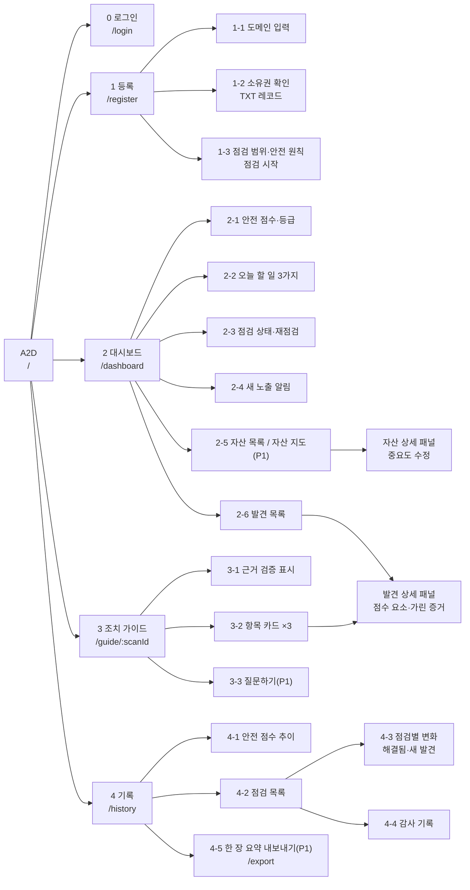
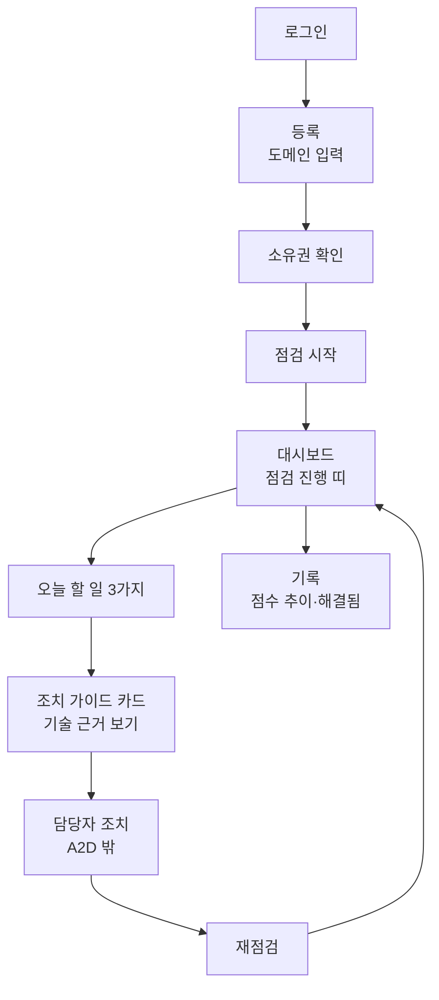

# A2D 정보 구조도

Oct 31, 2026 · 정인호

**A2D 화면은 로그인과 등록·대시보드·조치 가이드·기록 네 개이고, 사용자는 대시보드에서 시작해 "오늘 할 일 → 조치 가이드 → 조치 → 재점검 → 기록"으로 움직인다.** 이 문서는 화면과 그 안의 구역, 이동 경로, 각 구역이 쓰는 API를 정한다. 화면 요구사항은 [A2D_PRD.md](A2D_PRD.md) 5장을, API는 [A2D_API명세.md](A2D_API명세.md)를 따른다.

## 1. 전체 구조

- **진입:** `/`는 로그인하지 않았으면 `/login`으로, 로그인했으면 등록된 도메인이 없을 때 `/register`, 있을 때 `/dashboard`로 보낸다.
- **로그인 화면**은 PRD의 화면 4개에 더한 입구 화면이다. 로그인 외의 구역은 없다.
- **발견 상세 패널**은 페이지가 아니라 오른쪽에서 열리는 패널이다. 대시보드의 발견 목록과 조치 가이드의 "기술 근거 보기"가 같은 패널을 쓴다.
- **P1 구역**(자산 지도, 질문하기, 내보내기)은 시간이 모자라면 빼도 나머지 구조가 깨지지 않게 둔다.

## 2. 공통 레이아웃

로그인·등록을 뺀 모든 화면에 같은 머리글이 있다.

| 구역 | 내용 | API |
| --- | --- | --- |
| 로고 | A2D 로고. 누르면 대시보드 | |
| 도메인 | 점검 대상 도메인 이름과 소유권 확인 표시 | `GET /domains/{id}` |
| 메뉴 | 대시보드 · 조치 가이드 · 기록 | |
| 점검 진행 띠 | 점검 중이면 머리글 아래에 단계와 진행률. 어느 화면에서든 보인다 | `GET /scans/{id}` (2초 폴링) |
| 기본 가이드 표시 | LLM이 꺼져 있으면 "기본 가이드로 표시 중" | `GET /health` |
| 사용자·로그아웃 | 로그인한 사용자 이름과 "로그아웃" 버튼 | `GET /auth/me`, `POST /auth/logout` |

## 3. 화면별 구성

### 0. 로그인 `/login`

시연용 계정으로 로그인한다. 회원가입과 비밀번호 찾기는 없다.

| ID | 구역 | 보여 줄 것 | 사용자 행동 | API |
| --- | --- | --- | --- | --- |
| 0-1 | 로그인 양식 | A2D 로고, 이메일·비밀번호 입력란, 오류 안내 | "로그인" | `POST /auth/login` |

- 틀리면 "이메일 또는 비밀번호가 맞지 않습니다."만 보여 준다. 어느 쪽이 틀렸는지는 알리지 않는다.
- 5회 연속 실패하면 "5분 뒤 다시 시도해 주세요."를 보여 준다(`429`).
- 세션이 만료돼 넘어왔으면 "다시 로그인해 주세요."를 위에 보여 준다.

### 1. 등록 `/register`

도메인을 등록하고 소유권을 확인한다(FR-01). 세 단계를 한 화면에서 차례로 진행한다.

| ID | 구역 | 보여 줄 것 | 사용자 행동 | API |
| --- | --- | --- | --- | --- |
| 1-1 | 도메인 입력 | 입력란, 형식 오류 안내 | 도메인 입력 → "다음" | `POST /domains` |
| 1-2 | 소유권 확인 | TXT 레코드 이름과 값(복사 버튼), DNS 반영 안내, 확인 상태 | "확인" | `POST /domains/{id}/verify` |
| 1-3 | 점검 범위·안전 원칙 | 읽기 전용, 소유권 확인 범위만, 속도 제한, 증거 가림 | "점검 시작" → 대시보드 | `POST /domains/{id}/scans` |

- 확인에 실패하면 1-2에 머물며 `reason`을 보여 준다.
- 1-3의 "점검 시작"은 소유권이 확인된 뒤에만 누를 수 있다.

### 2. 대시보드 `/dashboard`

**첫 화면에서 안전 점수와 오늘 할 일 3가지가 스크롤 없이 보여야 한다**(PRD 5장). 2-1과 2-2를 위쪽에 둔다.

| ID | 구역 | 보여 줄 것 | 사용자 행동 | API |
| --- | --- | --- | --- | --- |
| 2-1 | 안전 점수·등급 | 안전 점수(0~100), A~F 등급(색 + 글자), 등급별 발견 수, 산식(펼치기) | 산식 펼치기 | `GET /domains/{id}/summary` |
| 2-2 | 오늘 할 일 3가지 | 순서, 쉬운 제목, 자산, 발견 등급, 예상 조치 시간, "고치면 안전 점수 ○점" | 항목 → 조치 가이드의 해당 카드 | `summary.today_tasks` |
| 2-3 | 점검 상태·재점검 | 마지막 점검 시각, 진행 중이면 단계·요청 예산, 중지 버튼 | 재점검, 중지 | `POST /domains/{id}/scans`, `POST /scans/{id}/stop` |
| 2-4 | 새 노출 알림 | 직전 점검 대비 새 자산·새 발견 | 알림 → 자산·발견 패널 | `summary.alerts` |
| 2-5 | 자산 목록 | 별칭, 주소, 자산 중요도, 부품·버전(지원 종료 표시), 최고 발견 등급, 새 자산 표시 | 자산 → 자산 상세 패널 | `GET /scans/{id}/assets` |
| 2-6 | 발견 목록 | 점검 항목 이름, 자산, 상황, 위험 점수, 등급, 확실성, 상태 | 등급·자산으로 거르기, 발견 → 발견 상세 패널 | `GET /scans/{id}/findings` |

**자산 상세 패널:** 자산 정보, 찾은 방법(#1~#5), 부품 목록(#24), TLS 버전, 이 자산의 발견, 자산 중요도 수정(1~5). 중요도를 바꾸면 2-1·2-2가 바로 다시 그려진다(`PATCH /domains/{id}/assets/{asset_id}`).

**발견 상세 패널:** 점검 항목 이름과 번호, 위치, 상황, 등급·확실성, 점수 요소(E·X·D·C, 신뢰도)와 산식, 가린 증거, CVE(#23만). `GET /findings/{finding_id}`.

### 3. 조치 가이드 `/guide/:scanId`

오늘 할 일 3가지를 비전문가 언어로 설명한다(FR-07, 08, 11). `:scanId`가 없으면 최근 점검으로 연다.

| ID | 구역 | 보여 줄 것 | 사용자 행동 | API |
| --- | --- | --- | --- | --- |
| 3-1 | 근거 검증 표시 | "근거 검증 통과 3/3", AI 설명인지 기본 가이드인지 | | `GET /scans/{id}/report` |
| 3-2 | 항목 카드 ×3 | 제목, 왜 위험한가, 예상 피해, 조치 방법(단계), 예상 조치 시간, 고치면 안전 점수 | "기술 근거 보기" → 발견 상세 패널 | `report.items` |
| 3-3 | 질문하기 (P1) | 입력란, 답변, 근거 발견 링크 | 질문 → 답변의 근거 링크 → 발견 상세 패널 | `POST /scans/{id}/questions` |

- 기술 용어는 카드에 두지 않고 발견 상세 패널에만 둔다(PRD 5장 공통 규칙).
- 카드 아래에 "고친 뒤 재점검" 버튼을 두어 대시보드의 재점검과 같은 동작을 한다.

### 4. 기록 `/history`

조치 효과를 보여 주고 경영진에게 공유한다(FR-10, 13, 16).

| ID | 구역 | 보여 줄 것 | 사용자 행동 | API |
| --- | --- | --- | --- | --- |
| 4-1 | 안전 점수 추이 | 점검별 안전 점수 선 그래프, 등급 구간 | 점 → 그 점검 선택 | `GET /domains/{id}/history` |
| 4-2 | 점검 목록 | 시각, 안전 점수·등급, 새 발견 수, 해결 수 | 점검 선택 | `history.items` |
| 4-3 | 점검별 변화 | 점수 전후, 해결됨·새 발견·새 자산 목록 | 발견 → 발견 상세 패널 | `GET /scans/{id}/changes` |
| 4-4 | 감사 기록 | 시각, 주체(코드·Attack·Defense), 도구, 인자, 결과, 거부 사유 | 주체·거부만 거르기 | `GET /scans/{id}/audit` |
| 4-5 | 내보내기 (P1) | 한 장 요약 인쇄 페이지 `/export`로 이동 | 브라우저 인쇄로 PDF 저장 | `summary`, `history` |

**한 장 요약 `/export`:** 안전 점수와 등급, 오늘 할 일 3가지, 점수 추이 그래프를 A4 한 장에 담는다. 머리글과 메뉴는 없다.

## 4. 사용자 흐름

시연 흐름(기획서 "시연 흐름 3분")과 같은 순서다.

## 5. 화면 상태

| 화면 | 상태 | 보여 줄 것 |
| --- | --- | --- |
| 공통 | 로그인 안 함 | `/login`으로 이동 |
| 공통 | 세션 만료 (`401`) | `/login`으로 이동하고 "다시 로그인해 주세요." |
| 공통 | 도메인 없음 | `/register`로 이동 |
| 공통 | API 오류 | 오류 `message`와 "다시 시도" |
| 대시보드 | 첫 점검 진행 중 | 점수 대신 진행 단계와 진행률 |
| 대시보드 | 발견 0건 | 안전 점수 100(A)와 "오늘 할 일 없음" |
| 대시보드 | 점검 중지됨 | 마지막 결과와 "중지된 점검" 표시 |
| 조치 가이드 | 점검 진행 중 | "점검이 끝나면 조치 가이드가 만들어집니다" |
| 조치 가이드 | 기본 가이드 | "기본 가이드" 표시. 형식은 같음 |
| 기록 | 점검 1회뿐 | 그래프 대신 점수 하나와 "재점검하면 변화가 보입니다" |

## 6. 화면 용어

화면에는 아래 표기만 쓴다. API 코드 값과의 대응은 [A2D_API명세.md](A2D_API명세.md) 1장 "코드 값"을 따른다.

| 용어 | 뜻 |
| --- | --- |
| 안전 점수 | 0~100. 높을수록 안전 |
| 등급 | 조직 등급 A~F |
| 긴급 · 높음 · 중간 · 낮음 · 참고 정보 | 발견 하나의 등급 |
| 확인됨 · 가능성 · 확인 필요 | 확실성 |
| 해결됨 · 새 발견 | 재점검에서 직전 점검과 비교한 상태 |
| 오늘 할 일 | 고쳤을 때 안전 점수가 가장 많이 오르는 발견 3개 |
| 기본 가이드 | LLM 없이 템플릿 문장으로 만든 조치 가이드 |
