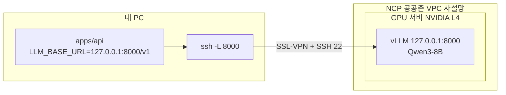

# model · AI 모델 배포 스크립트

담당: 김강현 · 커밋 scope: `model`

Attack·Defense 에이전트가 쓰는 LLM을 주최 측 GPU 서버에 띄우는 스크립트와 설정 순서를 둔다. 백엔드(`apps/api`)는 여기서 띄운 OpenAI 호환 엔드포인트만 부른다.

| 항목 | 값 |
| --- | --- |
| 모델 | Qwen3-8B (BF16, Apache 2.0), revision `b968826d9c46` |
| 서빙 | vLLM 0.31.0, OpenAI 호환 엔드포인트, 도구 호출(`hermes` 파서), 생각 모드 파서(`qwen3`) |
| 실행 환경 | Python 3.12 가상 환경(uv). torch 2.13.0 + CUDA 13.0 런타임 |
| 서버 | NCP 공공존 VPC, NVIDIA L4 (23GB), 드라이버 580 (CUDA 13.0) |
| 문맥 길이 | 8,192 토큰으로 시작. 메모리가 남으면 16,384까지 올린다 |
| 접속 | 사설망. SSL-VPN을 연결한 뒤 SSH 터널로만 붙는다 |

| 파일 | 내용 |
| --- | --- |
| `llm.sh` | 서버 점검·설치·내려받기·실행·종료·상태·터널을 하나로 묶은 스크립트 |
| `check.py` | 엔드포인트 점검: 모델 목록, 한국어 설명, 도구 호출. 표준 라이브러리만 쓴다 |
| `.env.example` | 설정 키와 기본값. `.env`로 복사해 쓰고, 주소·계정·키 값은 커밋하지 않는다 |

## 구성



GPU 서버가 지키게 하는 조건(주최 측 매뉴얼 기준)이 이 구성을 정한다.

- **인터넷에서 직접 접속할 수 없다.** SSL-VPN을 연결해야 사설 IP에 닿고, VPN을 연결해도 ACG가 허용한 SSH 포트만 열린다.
- **방화벽·포트·드라이버·CUDA를 바꾸거나 임의로 재부팅하지 않는다.** 그래서 vLLM 포트를 열지 않고 `127.0.0.1`에 묶은 뒤 SSH 터널로 쓴다. sudo와 Docker 없이 사용자 홈에 설치한다.
- **VPN·서버 비밀번호와 OTP는 다른 사람과 공유하지 않는다.** 터널은 계정 주인만 열 수 있다. 시연은 터널을 연 PC에서 `apps/api`·`apps/web`·`target`을 함께 띄워 녹화한다.
- **개인정보나 반출이 제한된 데이터를 올리지 않는다.** 서버에는 모델 가중치와 이 스크립트만 둔다. 점검 결과는 상세설계 3절대로 가린 발췌만 LLM에 보낸다.
- **11월 1일(일) 13:00에 서버가 삭제되고 복구할 수 없다.** 시연 영상과 증거는 그 전에 받아 둔다([삭제 전에 할 일](#서버-삭제-전에-할-일)).

VPN 주소, 계정, 서버 사설 IP, SSH 포트는 `private/해커톤_GPU_서버_사용_메뉴얼.pdf`와 운영진 안내에 있다. 이 문서와 커밋에는 적지 않는다.

## GPU 서버 설정 순서

처음 한 번은 1~8을 순서대로 한다. 서버를 다시 쓸 때는 VPN 연결, SSH 접속, `./llm.sh up`이면 된다.

### 빠른 실행

VPN 연결과 SSH 접속(1~2)을 마친 뒤 서버에서:

```bash
cd ~/A2D/model                 # model/을 올린 위치
./llm.sh preflight             # 환경 점검. [X]가 있으면 아래 3단계 표를 본다
tmux new -s a2d                # SSH가 끊겨도 이어지게
./llm.sh deploy                # 설치 → 모델 내려받기 → 실행 → 확인
```

`deploy`는 4~7단계를 차례로 실행하고, 실패한 단계에서 멈춘다. 고친 뒤 다시 실행하면 끝난 단계는 건너뛴다. 마지막에 `[check] 통과`가 나오면 서버 쪽은 끝이고, 내 PC에서 8단계(터널)를 한다. 단계별로 따로 돌리려면 아래 3~8을 본다.

### 1. SSL-VPN 연결 (내 PC)

1. 공공존 SSL-VPN Agent를 설치한다(Windows·macOS용). 다운로드 주소는 매뉴얼 4쪽에 있다.
2. Agent에서 **VPN 추가**를 누르고, 운영진이 준 VPN 도메인과 아이디·비밀번호를 넣는다. 이메일이나 SMS로 온 OTP를 넣고 VPN 이름을 정해 저장한다.
3. VPN을 고르고 아이디·비밀번호·OTP로 연결한다. 상태가 **연결됨**이면 된다.
4. 연결을 확인한다. 운영진이 알려 준 VPN IP 대역의 주소가 잡혀야 한다.

   ```bash
   ip addr          # Linux    (Windows: ipconfig)
   nc -vz <서버 사설 IP> <SSH 포트>   # Windows: Test-NetConnection <IP> -Port <포트>
   ```

매뉴얼에는 Windows·macOS용 Agent만 있다. 터널은 VPN을 연결한 기기에서만 열 수 있으므로, 리눅스 PC로 시연하려면 운영진에게 리눅스 접속 방법을 먼저 묻는다. 없으면 Windows·macOS 기기에서 터널을 열고 시연한다.

### 2. SSH 접속과 스크립트 올리기

```bash
ssh -p <SSH 포트> <계정>@<서버 사설 IP>
```

첫 접속에서는 호스트 키 지문을 확인하고 `yes`를 입력한다. 비밀번호는 입력해도 화면에 보이지 않는다.

서버에 `model/`만 올린다. 저장소가 공개라 서버에 인터넷이 되면 바로 받아도 되고, 안 되면 내 PC에서 `scp`로 올린다.

```bash
# 서버에서 (인터넷이 될 때)
git clone https://github.com/unexpected-hackathon/A2D.git ~/A2D && cd ~/A2D/model

# 또는 내 PC에서
scp -P <SSH 포트> -r model <계정>@<서버 사설 IP>:~/a2d-model
```

긴 작업(설치·내려받기)은 SSH가 끊겨도 이어지도록 `tmux new -s a2d` 안에서 돌린다. 다시 붙을 때는 `tmux attach -t a2d`를 쓴다.

### 3. 서버 환경 점검

```bash
./llm.sh preflight
```

| 항목 | 기대 | 아니면 |
| --- | --- | --- |
| 외부 인터넷 (huggingface.co, pypi.org, astral.sh) | 모두 `[O]` | [외부 인터넷이 막혀 있을 때](#외부-인터넷이-막혀-있을-때) |
| sudo, Docker | 없어도 된다 | 스크립트는 둘 다 쓰지 않는다 |
| GPU | NVIDIA L4, 드라이버가 CUDA 13.0 이상 지원 | `nvidia-smi` 결과와 서버명을 운영진에게 전달 |
| 디스크 | 홈에 여유 40GB 이상 | `du -sh ~/* ~/.cache/*`로 정리. 가중치 약 16GB, 가상 환경 약 10GB |
| 포트 8000 | 비어 있음 | `.env`의 `VLLM_PORT`를 바꾼다 |

`.env`가 없으면 이때 `.env.example`을 복사해 만든다(권한 600).

### 4. vLLM 설치

```bash
./llm.sh setup
```

uv가 없으면 `~/.local/bin`에 설치하고(sudo 불필요), `model/.venv`에 Python 3.12 가상 환경을 만들어 `vllm==0.31.0`을 넣는다. torch와 CUDA 런타임을 함께 받으므로 몇 분 걸린다. 마지막에 `GPU 인식: True (NVIDIA L4)`가 나와야 한다.

### 5. 모델 내려받기

```bash
./llm.sh download
```

`MODEL_DIR`(기본 `~/models/Qwen3-8B`)에 고정 revision으로 약 16GB를 받는다. 끊기면 같은 명령을 다시 실행하면 이어 받는다.

### 6. 실행

```bash
./llm.sh up
```

- 백그라운드(`setsid nohup`)로 띄우므로 SSH를 끊어도 계속 돈다. 로그는 `model/logs/vllm.log`.
- `/health`가 응답할 때까지 기다린다. 첫 실행은 가중치 적재와 컴파일 때문에 3~10분 걸린다.
- `.env`의 `VLLM_API_KEY`가 비어 있으면 무작위 키를 만들어 적는다. 이 값을 백엔드 `LLM_API_KEY`에 넣는다. 키는 명령줄이 아니라 환경 변수로 넘겨 `ps`에 보이지 않는다.

실제로 넘기는 옵션은 아래와 같다. 옵션 이름은 vLLM v0.31.0 소스에서 확인했다. 버전을 바꾸면 `.venv/bin/vllm serve --help=all`로 다시 확인한다.

```bash
vllm serve ~/models/Qwen3-8B \
  --served-model-name qwen3-8b --host 127.0.0.1 --port 8000 \
  --dtype bfloat16 --max-model-len 8192 --gpu-memory-utilization 0.90 --max-num-seqs 8 \
  --enable-auto-tool-choice --tool-call-parser hermes \
  --reasoning-parser qwen3 \
  --default-chat-template-kwargs '{"enable_thinking": false}'
```

| 명령 | 하는 일 |
| --- | --- |
| `./llm.sh status` | 프로세스, `/health`, GPU 메모리 |
| `./llm.sh logs` | 로그 따라 보기 |
| `./llm.sh down` | 내리기 |

### 7. 서버에서 확인

```bash
./llm.sh check --thinking --save logs/evidence
```

| 확인 | 통과 조건 |
| --- | --- |
| 모델 목록 | `qwen3-8b`가 있고 최대 문맥이 설정값과 같다 |
| 한국어 설명 | 가상 발견 F-0008을 쉬운 한국어로 설명한다. 답에 `<think>`가 섞이지 않는다. 걸린 시간과 초당 토큰을 출력한다 |
| 도구 호출 | 상세설계 4절의 `check_unauth_api` 정의를 주면 `tool_calls`로 `A-03`·`E-07`(또는 `E-08`)을 호출한다 |
| 생각 모드 (`--thinking`) | 생각 모드를 켰을 때의 지연을 잰다. 꺼 둘지 정하는 근거로 쓴다 |

`--save`는 요청·응답 JSON을 저장한다. 발표 증거로 내 PC에 받아 둔다(`logs/`는 커밋하지 않는다).

### 8. 내 PC에서 터널 열기

내 PC의 `model/.env`에 `GPU_SSH_HOST`·`GPU_SSH_PORT`와 서버 `.env`의 `VLLM_API_KEY` 값을 적는다. VPN을 연결한 상태에서 실행한다.

```bash
./llm.sh tunnel          # 열어 둔 동안만 연결된다. 다른 터미널에서:
./llm.sh check --local   # 내 PC 127.0.0.1:8000을 거쳐 확인
```

`llm.sh`를 쓰지 않을 때의 같은 명령:

```bash
ssh -N -L 127.0.0.1:8000:127.0.0.1:8000 -p <SSH 포트> <계정>@<서버 사설 IP>
```

## 백엔드에서 부르기

`apps/api`는 아래 환경 변수 세 개만 읽고, LLM 호출부를 한 곳에 모은다(상세설계 3절).

```bash
LLM_BASE_URL=http://127.0.0.1:8000/v1   # 터널 주소
LLM_API_KEY=<GPU 서버 .env의 VLLM_API_KEY>
LLM_MODEL=qwen3-8b
```

```python
from openai import OpenAI

client = OpenAI(base_url=os.environ["LLM_BASE_URL"], api_key=os.environ["LLM_API_KEY"], timeout=60)
resp = client.chat.completions.create(
    model=os.environ["LLM_MODEL"],
    messages=messages,
    tools=tools,                # 에이전트별로 허용된 도구만 넣는다
    tool_choice="auto",
    temperature=0.3,
    # 생각 모드를 요청마다 켤 때만. 기본은 꺼져 있다.
    # extra_body={"chat_template_kwargs": {"enable_thinking": True}},
)
msg = resp.choices[0].message   # msg.tool_calls 또는 msg.content
```

- 도구 호출 결과는 `message.tool_calls`로 온다. `function.arguments`는 JSON 문자열이라 가드 층에서 스키마로 다시 검증한다.
- 생각 모드를 켜면 생각은 `message.reasoning_content`(또는 `reasoning`)로 따로 오고 `content`에는 섞이지 않는다. 생각은 화면에 내보내지 않는다.
- `GET /health`(API 명세 4절)의 `llm` 값은 `GET {LLM_BASE_URL}/models`를 짧은 제한 시간(예: 5초)으로 불러 200이면 `up`으로 보기를 권한다. vLLM 자체의 `/health`는 `/v1` 밖에 있고 키 없이 열려 있어 모델 이름까지는 확인하지 못한다. LLM이 실패하면 조치 가이드를 기본 가이드(`source: template`)로 만든다(FR-11).
- 문맥이 8,192 토큰이므로 입력(시스템 프롬프트, 도구 정의, 발견 요약)과 `max_tokens`의 합이 이를 넘지 않게 한다.

## 설정값

`.env`에서 바꾸고 `./llm.sh down && ./llm.sh up`으로 다시 띄운다.

| 키 | 기본값 | 설명 |
| --- | --- | --- |
| `MAX_MODEL_LEN` | 8192 | 요청 하나의 입력 + 출력 최대 토큰 |
| `GPU_MEMORY_UTILIZATION` | 0.90 | vLLM이 쓰는 GPU 메모리 비율. 가중치 약 16.4GB를 빼고 남은 만큼이 KV 캐시가 된다 |
| `MAX_NUM_SEQS` | 8 | 동시에 처리하는 요청 수 |
| `ENABLE_THINKING` | false | 생각 모드 기본값. 요청에서 `chat_template_kwargs`로 바꿀 수 있다 |
| `VLLM_PORT` | 8000 | 서버 안의 포트. 바깥에 열지 않는다 |
| `LOCAL_PORT` | 8000 | 내 PC에서 터널이 여는 포트 |

메모리 어림: L4 23GB × 0.90 ≈ 20.7GB에서 가중치 16.4GB와 실행 여유 약 1.5GB를 빼면 KV 캐시가 약 2.5~3GB 남는다. Qwen3-8B는 토큰당 KV가 약 144KB(36층 × KV 헤드 8 × 128차원 × K·V × 2바이트)라 약 1만 7천~2만 토큰이 들어간다. 8,192 문맥 요청 두 개를 동시에 처리할 수 있는 정도다. 로그의 `GPU KV cache size`와 `Maximum concurrency` 줄로 실제 값을 확인한다.

## 외부 인터넷이 막혀 있을 때

> 아래 순서는 서버에서 시험하지 않았다. `preflight`에서 인터넷이 막혀 있으면 이 순서로 시도한다.

내 PC에서 받아 `scp`로 올린다. 가중치 약 16GB와 패키지 약 6GB를 VPN으로 보내므로 시간이 오래 걸린다.

```bash
# 내 PC: 가중치
uvx --from huggingface_hub hf download Qwen/Qwen3-8B \
  --revision b968826d9c46dd6066d109eabc6255188de91218 --local-dir ~/models/Qwen3-8B
scp -P <SSH 포트> -r ~/models/Qwen3-8B <계정>@<서버 사설 IP>:~/models/

# 내 PC: 서버용 패키지 휠 (서버 Python 버전에 맞춘다. 아래는 3.12)
pip download "vllm==0.31.0" -d wheels --only-binary=:all: --python-version 3.12 \
  --platform manylinux_2_28_x86_64 --platform manylinux_2_17_x86_64 --platform manylinux2014_x86_64
tar czf wheels.tgz wheels && scp -P <SSH 포트> wheels.tgz <계정>@<서버 사설 IP>:~/

# 서버: 서버에 있는 python3로 가상 환경을 만들고 휠로 설치
tar xzf ~/wheels.tgz -C ~ && python3 -m venv .venv
.venv/bin/pip install --no-index --find-links ~/wheels "vllm==0.31.0"
```

서버의 python3가 3.12가 아니면 `--python-version`을 서버 버전에 맞춘다. 그다음 `./llm.sh up`부터 진행한다.

## 문제 해결

| 증상 | 확인·조치 |
| --- | --- |
| `up` 중 `CUDA out of memory` | `MAX_MODEL_LEN`을 6144나 4096으로 줄인다. 그래도 안 되면 `GPU_MEMORY_UTILIZATION`을 0.92로 올린다. 다른 프로세스가 GPU를 쓰는지 `nvidia-smi`로 본다 |
| `No available memory for the cache blocks` | 가중치를 올린 뒤 남은 메모리가 없다. 위와 같다. 마지막 수단은 Qwen3-8B-FP8(약 8.5GB)로 바꾸는 것이고, 바꾸면 루트 README 외부 자원 표와 결정 기록도 고친다 |
| 도구 호출 확인에서 `tool_calls 없음` | 로그에 `--enable-auto-tool-choice`와 `hermes`가 있는지 본다. 내용에 `<tool_call>` 문자열이 그대로 있으면 파서가 꺼진 것이다 |
| 답에 `<think>`가 섞임 | `--reasoning-parser qwen3`이 빠졌다. `./llm.sh logs`에서 실행 옵션을 확인한다 |
| `HTTP 401` | 내 PC `.env`의 `VLLM_API_KEY`가 서버 `.env`와 다르다 |
| `연결 실패` (서버에서) | `./llm.sh status`. 프로세스가 없으면 `logs/vllm.log` 마지막 부분을 본다 |
| `연결 실패` (내 PC에서) | VPN이 끊겼거나 터널 창이 닫혔다. `./llm.sh tunnel`을 다시 연다 |
| 터널에서 `bind: Address already in use` | 내 PC에서 8000 포트를 다른 프로그램이 쓴다. `.env`의 `LOCAL_PORT`를 바꾸고 `LLM_BASE_URL`도 맞춘다 |
| 첫 `up`이 20분을 넘김 | `./llm.sh logs`에서 멈춘 단계를 본다. 내려받기가 덜 됐으면 `./llm.sh download`를 다시 실행한다 |

## 서버 삭제 전에 할 일

11월 1일(일) 13:00에 서버가 삭제된다. 그 전에 끝낸다.

- [ ] `./llm.sh check --thinking --save logs/evidence`를 실행하고, 결과와 `nvidia-smi` 화면을 내 PC로 받는다(`scp -P <포트> -r <계정>@<IP>:<서버의 model 경로>/logs ./gpu-evidence`)
- [ ] 상세설계 3절의 한국어 품질 확인: 시연 결함 발견 5건으로 Defense 리포트를 만들어 보고, 부족하면 프롬프트를 고친다
- [ ] 전체 시연 영상 녹화: 터널을 연 PC에서 `target` → `apps/api` → `apps/web`을 띄우고 점검 → 조치 → 재점검까지
- [ ] 운영진에게 서버를 2차 심사까지 유지할 수 있는지 확인(결정 기록 미결 항목)

## 서버가 없을 때 개발하기

GPU 서버에 붙을 수 없는 팀원과 11월 1일 이후에는 아래처럼 한다.

- 기본: `LLM_BASE_URL`을 비워 두면 백엔드가 LLM 없이 기본 가이드(`source: template`)를 내도록 만든다. 점검·점수·리포트 흐름은 LLM 없이 끝까지 돈다(FR-11).
- 에이전트 개발: 같은 OpenAI 호환 API를 주는 다른 서버로 `LLM_BASE_URL`만 바꾼다. 다른 모델이나 서비스를 쓰면 루트 README 외부 자원 표에 먼저 적는다.
